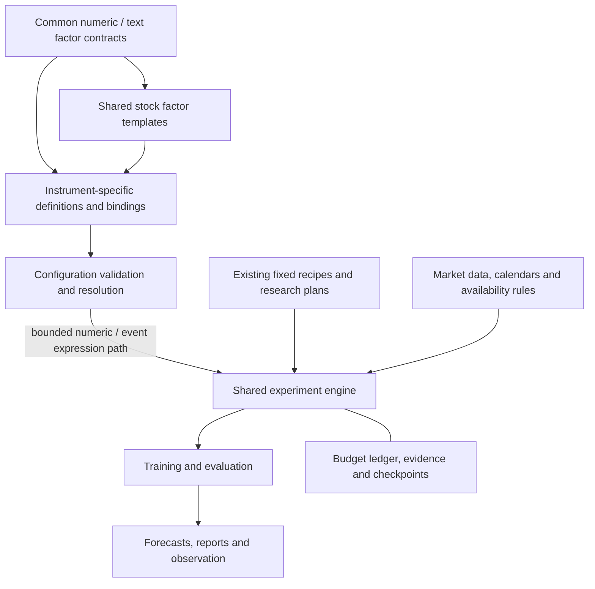
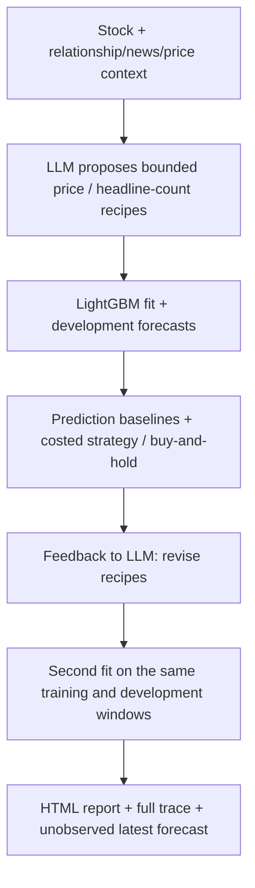

# Quant RSI

**Run one stock research study: context, factor proposals, models, strategy comparison and a report.**

After [installation](#installation-and-usage), run from the repository root:

```bash
quant-rsi research-study KO --output /tmp/ko-study
```

In an interactive terminal, this opens a local live UI: an animated research graph,
clickable stage outputs, and the final comparison report. Use `--no-ui` for terminal-only
runs, or `--ui` to open it explicitly. Completed views are saved as `live.html` alongside
the report; no frontend install is needed. Node outputs include news cards, factor changes,
interactive prediction/NAV charts and metric tables, with raw JSON available on demand.
See the [live UI guide](docs/connected_research_study.md#live-research-ui).

This connects configured company relationships, issuer news, daily prices, two
Codex hypothesis calls and two real LightGBM fits. Open `/tmp/ko-study/report.html`
for prediction baselines, initial/revised strategies versus buy-and-hold, costs,
Sharpe, volatility, maximum drawdown and the latest forecast. Use a new output path
for each study. Before research, the study reserves 10 terminal observations. After
development selection, it evaluates the chosen fitted model once on that interval,
with separate forecast and costed strategy tables. Risk statistics remain short-sample
descriptions; current-news/LLM knowledge prevents treating this as prospective validation.

To let the LLM search current news, read selected public pages and suggest related
companies with source citations, use the same entry point:

```bash
quant-rsi research-study KO --news-research --output /tmp/ko-active-study
```

This adds at most one follow-up search request before the two model fits. Missing
readable sources trigger that recovery request even if the LLM proposes no follow-up;
failures and recovery queries stay visible. The UI and report connect cited news to
each hypothesis and distinguish **fitted**, **not selected**, and **unavailable** factors.
Citations explain the research rationale, not the size of a source's effect on prediction.
Current articles are never backdated into historical features.

XOM also has a complete study configuration, using its official issuer RSS and
a dated CVX business relationship. Run the same flow with
`quant-rsi research-study XOM --news-research --output /tmp/xom-active-study`.
Its local factor combines XOM and CVX returns; the engine and model are shared.
See the [second-stock example](docs/connected_research_study.md#second-stock-example-xom)
for coverage and evidence limits.

With the [optional Qlib environment](docs/qlib_workflow_comparison.md), add
`--compare-qlib` to run one actual upstream fit on the selected study's frozen
features and splits. The same report compares forecasts and costed accounts;
the comparison adds one declared fit and does not change research selection.

The study also resolves the stock's factor profile: shared definitions, local definitions
and bounded compositions retain their source bindings and ownership. KO can reuse the
shared momentum recipe for KO and KOF and combine them in its own configured factor.
Unavailable business sources remain pending. Factor cards and the report show what can
run and what was selected. Explicit `--catalog` keeps the standalone catalog path;
see [factor layers and execution](docs/factor_layers.md#execution-in-the-connected-study).

Add `--history-dir /tmp/ko-research-history` to connect separate study runs. The next
run observes prior forecasts using newly received prices and passes mature outcomes
to the LLM, while sharing the retained news archive. The UI shows pending and observed
forecasts with price error, costed return and Sharpe. Use `research-history observe`
to update outcomes without another fit; see [continuous research](docs/connected_research_study.md#continue-research-across-market-days).
Late forecasts remain non-prospective, and account results are hypothetical.
The research view also freezes the history seen at the start of that run, marks which
mature outcomes were supplied as feedback, and compares the previous selected factor
set with this run's selected model. Pending outcomes remain unknown.

The study adopts a revision only when its **development MAE strictly improves**;
otherwise it retains the incumbent for the latest forecast. To choose strategy
Sharpe instead, set `--selection-metric sharpe` before the run. Ties and unavailable
comparisons retain the incumbent. All attempts remain in the report; this is
development selection, not independent validation. Stage progress goes to stderr
(`--quiet` hides it); `runtime.json` records elapsed time, call counts and reported
token usage without estimating a monetary cost.

For a bounded multi-round study, keep the same entry point:

```bash
quant-rsi research-study KO --rounds 5 --max-fits 4 --patience 2 \
  --news-research --output /tmp/ko-multi-round-study
```

This permits at most four fits, stopping earlier after two consecutive trials fail to
improve the incumbent. The UI/report shows each round, its factors, MAE, net return,
Sharpe, adoption decision and the stopping reason. Later hypotheses receive the
incumbent's feedback and the complete development trial history. Terminal evaluation
does not consume another fit or feed another revision. The defaults remain two fits
and 10 reserved terminal observations. Use `--terminal-sessions 0` for the previous
development-only window. See [iteration limits](docs/connected_research_study.md#bounded-research-iterations)
and [terminal evaluation](docs/connected_research_study.md#reserved-terminal-evaluation).

To try the same report offline, with real model fits on synthetic inputs:

```bash
quant-rsi research-study KO --output /tmp/ko-study-offline \
  --llm simulated --related simulated --news simulated --prices synthetic
```

The [connected study guide](docs/connected_research_study.md) explains prerequisites,
options, artifacts and interpretation. Feedback revises bounded price recipes and
headline-count recipes when receipt-time news history supports them. `--news-research`
also extracts issuer earnings-guidance changes with source quotes and completion times.
The resulting guidance factors can enter training when retained history supports them,
and can be removed in the next research round;
both attempts use the same development observations, so a better second result
is not independent evidence of improvement. The latest forecast has no observed
outcome. RSI means **recursive self-improvement** here; testing whether research
feedback improves independent results remains the longer-term goal.

The smaller `research-demo` entry point retains its existing defaults and
[replaceable-service guide](docs/simulated_research_loop.md). The separate bounded
engine retains its budget accounting, durable evidence and recovery capabilities.

[Quick start](#installation-and-usage) · [Capabilities](#current-capabilities) ·
[Guides](#documentation) · [Roadmap](#roadmap) · [Contributing](#development-and-validation)

## Architecture

Shared definitions live outside individual stocks. Each stock selects shared
templates and owns its source bindings, local hypotheses and factor relationships.



Validation alone does not make a definition a model input. The opt-in
[factor discovery path](docs/factor_discovery.md) executes selected numeric bindings
and registered event indicators; general text tasks and factor trees remain specifications.
Existing forecasts retain their registered recipes.
CALM's egg-price relationships belong to its own configuration; KO can reuse the
same stock-price template without inheriting CALM's business assumptions.
See [factor ownership and types](docs/factor_layers.md).

| Location | Responsibility |
| --- | --- |
| `src/quant_rsi/` | Shared data, factor contracts, research, forecast, evaluation and execution code |
| `instruments/shared/` | Reusable stock factor templates |
| `instruments/<MARKET>/<SYMBOL>/` | Instrument profiles, factor bindings and local relationships |
| [`experimental/candidate_factors/`](experimental/candidate_factors/README.md) | Source-pinned open-source factor survey, licenses and integration examples; not runtime registrations |
| `examples/` and `tests/` | Runnable plans, small fixtures and offline regression tests |
| `docs/` | Operating guides, design specifications and experiment reports |
| `data/`, `runs/`, `.quant_rsi/` | Ignored local data, outputs and authoritative workspace state |

## Research workflow

The connected study follows one visible path:



The study defaults to 20 matured five-session forecasts, with training labels
strictly before the first evaluation origin. The revision sees those results,
so its comparison remains development analysis. Archived headlines can supply
keyword-count features only where their recorded reception precedes the relevant
close. Current news is not backfilled into historical rows. Strategy orders execute at
the next open in a hypothetical account; this is not live order submission.

For registered inputs and real LightGBM workers, use the separate
[bounded research workflow](docs/research_workflow.md). It connects discovery,
per-fold strategy/buy-and-hold reports and linked forecast/paper observation.
Its development forecast MAE drives discovery; account returns do not select
candidates. These capabilities can be connected to the product loop one step
at a time.

## Current capabilities

| Capability | Status and boundary |
| --- | --- |
| Connected research study | One command produces a trace and HTML/Markdown report with bounded recipe proposals, two model fits, prediction baselines and costed strategy comparisons; development feedback is reused |
| Simulated product loop | One stock-symbol command shows context, catalog-based factor selection, prediction, feedback, revised selection and a second prediction; each simulated service can be replaced independently |
| Live LLM hypotheses | Optional Codex CLI or OpenAI Responses API makes two independent calls with explicit feedback; current news is research context, not historical training data |
| Company relationships and prices | Configured links and optional source-cited suggestions feed bounded related-price collection (up to three symbols). Aligned peer-return and target-minus-peer-return factors can enter both fits; unavailable markets/history stay explicit. LLM suggestions remain unverified and do not rewrite profiles |
| Live news in the product loop | Registered RSS remains the default; optional active research uses Codex/API web search, bounded public-page reads and one optional follow-up request, with receipts, citations and failures in the report |
| News features in the connected study | Retained headline counts and, with active research, source-bound issuer guidance direction. Receipt/extraction clocks gate execution; insufficient history leaves factors pending. The synthetic demo exercises numerical news columns and their removal |
| Models in the product loop | LightGBM by default; `research-study --model ridge` uses a regularized linear alternative with training-only scaling on the same feature/maturity path. Two actual fits reuse development feedback; neither choice implies independent improvement |
| Actual Qlib workflow | Optional `research-study --compare-qlib` runs upstream DatasetH/LGBModel on the selected common inputs, with one additional fit, local recorder and shared costed account comparisons. This does not compare Qlib's portfolio engine or autonomous research |
| Study factor proposals | Momentum, mean return, local Qlib-style ROC/MA, trailing log-return volatility and eligible archived headline counts can enter the feature matrix. The LLM can also select related-price recipes from the run-local catalog; no arbitrary generated code |
| Daily prices in the product loop | Collect once or reuse verified daily evidence; report development errors separately from the latest-bar five-session forecast, whose outcome is unobserved |
| Bounded research workflow | One profile runs bounded discovery, costed per-fold strategy/buy-and-hold reports and linked forecast/paper observation; feedback uses development forecast MAE only |
| Five-session price forecasting | Available for explicitly supported sources/markets; includes collection, fixed-model research, model sealing and replay |
| Prospective forecast observation | Offline registration and append-only outcome settlement from observed market receipts; real prospective accumulation and outcome-driven policy updates remain outstanding |
| Enhanced forecast comparison | Available: three predefined price/context recipes, frozen folds, naive controls and a separate publication fit |
| Bounded factor research | Momentum/mean-return neighbor search, opt-in [plateau exploration](docs/research_exploration.md) under the same budget/checkpoint path, and limited registered research-program changes |
| Shared and instrument-specific factors | Numeric bindings can enter bounded discovery; general text definitions remain specifications |
| Automatic factor discovery | Finite multi-leaf compositions, feedback-dependent exploration and common multi-fold comparisons; no general proposer-program evolution |
| Candidate factor execution | Opt-in [Qlib ROC and MA close-price adapters](docs/candidate_factor_runtime.md) feed bounded discovery; the remaining survey candidates are not executable |
| Dynamic event factors | Registered title instances, observed lifecycle transitions, decay and archival; KO RSS observations can enter this path |
| Multi-branch factor discovery | CALM is a worked specification; its factor tree is not executable |
| News and financial evidence | Retained KO title indicators can enter opt-in comparisons/discovery; other evidence remains sidecar-only |
| News collection and extraction | [Bounded KO official RSS observations](docs/news_collection.md), retained-title extraction and revision tracking; the study adds current search/page text for hypotheses. The [first news-factor slice](docs/news_factor_slice.md) is implemented; general historical text-feature extraction remains under #8/#39 B |
| Statistical confirmation and promotion | Incomplete; protected evaluation is engineering-only and retains the incumbent |
| Intraday bars, model and IBKR paper trading | Standalone, offline-tested: IBKR adapter with a paper-only guard, intraday snapshots, fixed LightGBM development evaluation, replay simulator and paper-account episodes. Not yet wired into the C2/C4/C5 controller or `quant-rsi`; see the [intraday guide](docs/intraday_ibkr.md) |
| Live trading and general self-modification | Not implemented |

Older guides use project-local labels: **M0** is fixed-model execution, **C2** is
the factor research loop, **C4** is a research-program paired experiment, and
**C5** is protected evaluation. These are not standard quant/AI terms.

## Installation and Usage

Use **Linux and Python 3.12**. Process control uses POSIX locks, signals and resource
limits; Windows is not supported. Dependency installation needs network access.
Run from a fresh clone:

```bash
git clone https://github.com/natureofnature/Quant_RSI.git
cd Quant_RSI
python3.12 -m venv .venv
source .venv/bin/activate
python -m pip install -r requirements-dev.lock
python -m pip install --no-deps -e .
```

Run a connected study using your existing Codex CLI login and public data:

```bash
quant-rsi research-study KO --output /tmp/ko-study
```

For an offline study with the same model/report path:

```bash
quant-rsi research-study KO --output /tmp/ko-study-offline \
  --llm simulated --related simulated --news simulated --prices synthetic
```

See the [study guide](docs/connected_research_study.md) for cached prices, API mode,
account assumptions and report files. The output directory must be new and outside
the checkout. Failures retain completed stage traces without silently substituting
simulated services. To inspect the smaller original interaction, run
`quant-rsi research-demo KO`; its flags and independent worktree setup remain in
[the demo guide](docs/simulated_research_loop.md).

To retain current RSS snapshots across studies, add `--news-archive /tmp/ko-news`.
This builds receipt-time history going forward; collecting news now cannot make
it usable at earlier market closes. See [news archive and features](docs/connected_research_study.md#news-archive-and-features).

When ready to run real model workers, the bounded engine has a separate example:

```bash
export QUANT_RSI_WORKSPACE="$PWD"
mkdir -p runs/workflow-demo
python examples/prepare_research_workflow.py --fixture --output runs/workflow-demo
quant-rsi research-workflow run runs/workflow-demo/profile.json --max-fits 10 \
  > runs/workflow-demo/run.json
quant-rsi research-workflow report rfc39-demo > runs/workflow-demo/report.md
quant-rsi research-workflow replay rfc39-demo > runs/workflow-demo/replay.json
```

The default profile has two research rounds, two folds and a ten-fit allowance.
It reports strategy costs, risk and buy-and-hold comparisons on separate fold
accounts. Its invented historical prices establish no predictive or prospective
advantage. See the [workflow guide](docs/research_workflow.md) for existing inputs,
bounded resume, detailed status and later observations.

For the smaller synthetic kernel demonstration:

```bash
quant-rsi run examples/development.json --output runs/demo
quant-rsi status runs/demo
quant-rsi replay runs/demo
quant-rsi resume runs/demo
```

Expect two completed candidates and one deliberately rejected future-shift
candidate. `run` needs a new directory; use `resume` for an initialized experiment.
Commands return JSON: exit code zero can include candidate failures or budget
exhaustion, so inspect `execution_status` and candidate statuses.

Inspect the layered factor specifications without collecting data or training:

```bash
quant-rsi factors validate US CALM
quant-rsi factors validate US KO
```

These commands report `specification_only` and `runnable: false`. CALM validation
does not enable CALM forecasting; its exchange is outside the current adapter.
For market-data forecasts, follow the [baseline guide](docs/forecast_baseline.md)
or the [enhanced workflow guide](docs/enhanced_forecast_workflow.md). They cover
source access, supported contracts, explicit budgets and recovery.

## Results and limits

The recorded SOXL and KO enhanced experiments completed their engineering
workflows. The selected models did **not beat both naive controls on development
MAE**. See the [experiment report](docs/enhanced_forecast_results.md) for values,
sample sizes and qualifications. These are development results, not independent
confirmation of predictive advantage or trading profitability.

Historical source availability includes explicit assumptions. Preserve original
evidence and distinguish publication time from actual first-seen time. Failed
trials and unresolved costs remain recorded; replay does not create new evidence.
The worker is a process boundary for trusted computation, not a sandbox for
arbitrary generated code. Detailed contracts are in the
[workflow and recovery guide](docs/experiment_workflows.md).

## Roadmap

1. Use the optional live LLM hypothesis step to inspect selection and feedback
   behavior while keeping the rest of the loop runnable with simulated services.
2. Use issuer RSS and LightGBM on synthetic or collected daily prices, then replace remaining
   simulated data and services individually, inspecting each change.
3. Compare the resulting research methods under frozen tasks and budgets, using
   the native engine alongside compatible mature engines; measure useful results
   and the effort required to test a hypothesis.

The [issue audit and ownership map](docs/issue_status.md) separates delivered
specifications and bounded slices from remaining implementation and research work.
Track ongoing delivery in [#39](https://github.com/natureofnature/Quant_RSI/issues/39),
the [broader roadmap #1](https://github.com/natureofnature/Quant_RSI/issues/1) and
the specific gaps linked in that map. Historical architecture, news and competitive
RFCs remain useful design records; their closure does not establish scientific results.
The [architecture specification](docs/architecture.md) describes the target design;
it is not a declaration that every capability is implemented.

## Documentation

| Start here when you want to… | Guide |
| --- | --- |
| Run a complete study and inspect prediction/strategy reports | [Connected research study](docs/connected_research_study.md) |
| Run the stock-symbol product loop and replace simulated services | [Simulated research loop](docs/simulated_research_loop.md) |
| Run one profile through research, strategy comparison and observation | [Minimal research workflow](docs/research_workflow.md) |
| Run detailed commands or recover an experiment | [Experiment workflows and recovery](docs/experiment_workflows.md) |
| Run bounded discovery and manage event instances | [Factor discovery](docs/factor_discovery.md) |
| Understand shared factors and single-stock bindings | [Factor layers](docs/factor_layers.md) |
| Use the first source-pinned candidate adapters | [Candidate factor runtime](docs/candidate_factor_runtime.md) |
| Compare native price formulas with actual pinned Qlib operators | [Optional Qlib operator comparison](docs/qlib_operator_comparison.md) |
| Compare the selected study with an actual upstream Qlib workflow | [Optional Qlib workflow comparison](docs/qlib_workflow_comparison.md) |
| Inspect a company-specific factor tree | [CALM worked example](docs/calm_factor_discovery_example.md) |
| Run a five-session baseline or enhanced comparison | [Baseline](docs/forecast_baseline.md), [enhanced workflow](docs/enhanced_forecast_workflow.md) |
| Run bounded recursive market research | [Recursive market exploration](docs/recursive_market_exploration.md) |
| Import local data or observe a sealed model | [Local data and observation](docs/local_observer.md) |
| Register a published forecast and settle its observed outcome | [Forecast observations](docs/forecast_observations.md) |
| Collect IBKR intraday bars or run an IBKR paper episode | [Intraday and IBKR guide](docs/intraday_ibkr.md), [design](docs/intraday_ibkr_design.md) |
| Understand protected engineering evaluation | [Evaluation protocol](docs/c5_protocol.md) |
| Preserve versions and old experiment environments | [Version control](docs/version_control.md) |

The reference [R&D-Agent-Quant paper](2505.15155v2.pdf) informs the research
direction; its published results are not evidence for this implementation.

## Development and Validation

From the activated environment:

```bash
ruff check src tests examples/profile_validation.py
ruff format --check src tests examples/profile_validation.py
pytest -q
```

[CI](.github/workflows/ci.yml) uses pinned dependencies and offline fixtures,
including real LightGBM worker tests. It checks engineering behavior, not market
predictive quality. Start with tests relevant to a change, then run the required
broader checks; no coverage-percentage threshold is configured. For reproducible
timings and bounded logs, use `python examples/profile_validation.py --output
/tmp/quant-rsi-validation` with a fresh directory. Optional `--shards 2` keeps each
module's shared fixtures in one process; CI uses this two-process mode.
[Validation cost and test tiers](docs/validation_cost.md)
describes focused feedback and final-revision full-suite evidence. CI preserves
these profiles as artifacts for 14 days.

### Contributor Delivery

Use four-space Python indentation, standard naming conventions and Ruff formatting
(100-character lines). Keep dependency pins, commands and documentation in sync.
Submit changes through a temporary branch and a PR targeting `main`; include the
behavior change, related issues, actual validation results and checks not run.
Merge after required checks and review, then remove the temporary branch. Public
documentation, issues and PRs are written in English. See [AGENTS.md](AGENTS.md).

Keep credentials, datasets and verbose logs out of version control. Preserve
completed experiments and their recorded source/dependency environments; do not
rewrite manifests to make historical runs match new code.
