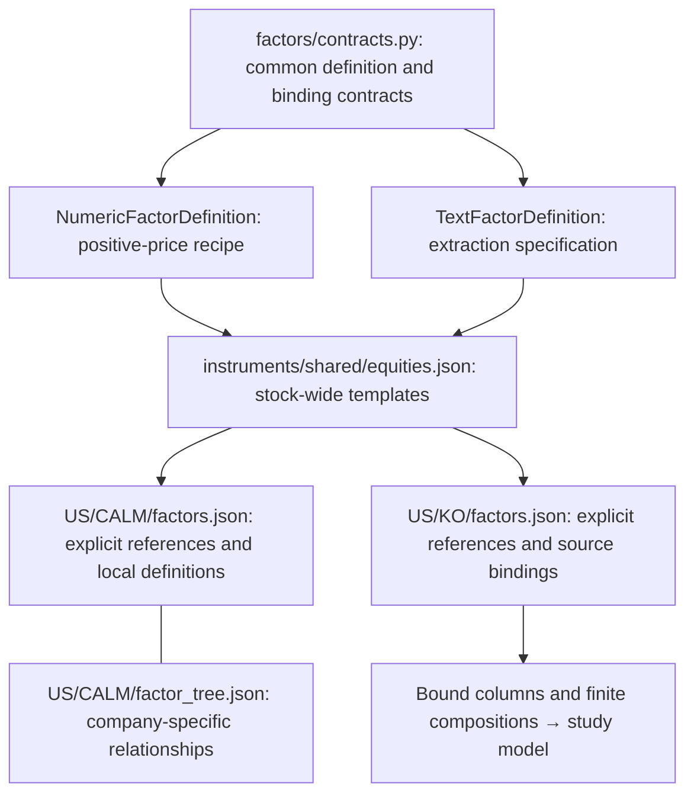

# Shared factor definitions and instrument bindings

Factor definitions are organized by **scope**, independently of whether their input
is numeric or textual. Shared processing contracts live in the engine; stock-wide
templates live outside individual stock directories; company-specific definitions,
source bindings and explanatory relationships live inside the stock directory.



## What each layer owns

| Layer | Responsibility | Example |
| --- | --- | --- |
| Common Python contracts | Define numeric/text variants and explicit source bindings | `NumericFactorDefinition`, `TextFactorDefinition` |
| Shared stock catalog | Reusable definitions without ticker-specific sources | Five-session stock momentum, issuer-event extraction specification |
| Instrument configuration | Select shared definitions; own local definitions and source bindings | CALM binds stock momentum to CALM, KO binds the same definition to KO |
| Instrument composition | Combine explicitly named bindings with bounded arithmetic | KO return minus the configured KOF bottler return |
| Instrument factor tree | Describe company-specific hypotheses and relationships | CALM's egg-price, supply and demand branches |

The shared definition describes a recipe, not a value shared by every stock and not
evidence that it predicts every stock. CALM's egg-price hypothesis belongs to CALM;
its arithmetic reuses the same numeric recipe contract. Nothing imports CALM's
local definitions into KO. Catalogs cannot import instruments or other catalogs,
and local definitions cannot silently override shared definitions.

An industry catalog can be added under `instruments/shared/` when several instruments
actually share definitions. Instruments must explicitly name it in `catalogs`.
Catalogs are composed, not automatically inherited; there is no precedence-based
override, directory scanning, or global mutable registry. A new parameterization
gets its own definition ID. Relationship graphs remain instrument-owned.

## Validate and inspect the resolved configuration

Use the [Python 3.12/Linux installation](../README.md#installation-and-usage).
From the repository root:

```bash
quant-rsi factors validate US CALM
quant-rsi factors validate US KO
# From another working directory, specify the checked-out configuration root:
quant-rsi factors validate US KO --root /absolute/path/to/instruments
```

The command reads `shared/<catalog>.json` and `<market>/<symbol>/factors.json`.
It reports each selected definition, its shared/instrument owner and its explicit
source binding. It rejects malformed numeric/text variants, duplicate IDs,
shadowing, unknown references, mismatched directory identities and paths escaping
the instruments root. Definitions not selected by a binding are not applied.
JSON output is detached from the parsed models; validation does not write files,
collect data, reserve budget or train. The API is
`quant_rsi.factors.catalog.resolve_instrument_factors(root, market, instrument)`.

## Execution in the connected study

`research-study` now resolves the target's `US/<symbol>/factors.json` by default.
It keeps shared definitions outside the stock directory, resolves local definitions,
and binds each usable column to its declared source. If no profile exists, it uses
the shared equities catalog and records that fallback. An invalid existing profile
is an error. `--factor-root /path/to/instruments` changes only factor configuration;
relationships/news keep their existing configuration paths. Explicit `--catalog`
opts out of profile bindings and preserves the standalone catalog path.

Runtime IDs are `bound.<binding_id>` so one shared definition can be bound more than
once. `definition_id`, `definition_scope`, `definition_owner` and `source` preserve
the meaning and ownership behind each instance. Local numeric definitions use the
same source checks; they do not become visible to other instruments.

| Declared binding | Supported execution |
| --- | --- |
| `target_daily_prices`, target entity, `close` field | Existing momentum, mean-return and supported Qlib-style price recipes |
| `related_daily_prices`, already collected peer, `close` field | Momentum at 5, 10 or 20 sessions, reusing the existing aligned peer-return column |
| Other source/entity/field combinations, unsupported related recipes, text extraction | Pending with a reason; no implicit target-price substitution |

`compositions` in an instrument profile reuse the finite `FactorExpression` grammar:
at most seven nodes and depth three, with `leaf`, `add`, `subtract` and `multiply`.
Each leaf names a declared binding. Nodes must be topologically ordered; unknown
bindings, duplicate/shadowed IDs, unused nodes and cycles are rejected. These are
configured arithmetic hypotheses, not learned causal relationships or generated code.

KO binds `equity.price_momentum_5` to both KO and KOF, then owns
`ko.relative_bottler_momentum`, their difference. KOF must already be present in the
related-price collection; the profile does not trigger extra collection. Availability
is fixed on the common training/development rows. Missing source values propagate
through compositions without imputation or row dropping. Missing terminal/latest
inputs produce explicit unavailable results, not another model or source.

The LLM can select these definitions alongside bounded run-local proposals and revise
its selection after feedback. `factor_profile.json` retains the resolved specification
and runtime eligibility. Selected predictions record bound input dependencies; factor
cards and reports show ownership, sources, composition nodes and pending reasons.

```bash
# Real fits on synthetic target/peer prices; configured KO relationships include KOF.
quant-rsi research-study KO --llm simulated --news simulated --prices synthetic \
  --related profile --rounds 3 --no-ui --output /tmp/ko-profile-study

# CALM target-price factors can run, while egg-price/cull sources remain pending.
quant-rsi research-study CALM --llm simulated --news simulated --prices synthetic \
  --related simulated --no-ui --output /tmp/calm-profile-study
```

The simulated proposer does not guarantee it will select a configured composition.
The catalog/report exposes its availability; actual selection is recorded per round.

### Recorded connected acceptance

A 2026-10-30 run used Codex, active news search and retained public KO/peer daily
collections with `--rounds 3`. It completed seven LLM calls, two search requests and
three real LightGBM fits. Round 1 selected `bound.price_momentum`,
`ko.relative_bottler_momentum` and `research.log_return_volatility_10`. Later rounds
changed the factors but increased development MAE (2.6715 → 2.9060 → 3.2069), so
the first fitted model was retained, including its composed KO/KOF column.

The reserved ten-observation terminal MAE was 2.7873, versus 2.4790 for unchanged
price. Net strategy return was 1.02% versus buy-and-hold 4.83%; descriptive Sharpe
was 2.7859 versus 3.6906. This verifies execution and retention of a losing comparison,
not predictive advantage. Terminal evaluation reused the selected model without
refitting. Current news and pretrained LLM knowledge are not historically isolated;
this was retrospective, not prospective validation. Live LLM choices are not
deterministic. Offline tests explicitly select and alter compositions to verify
feature values, fitted predictions, unavailable sources and terminal missingness.

## Validation and unsupported execution boundaries

Resolved output says `status: specification_only` and `runnable: false`.
Source IDs in these examples are proposed bindings, not registered providers,
data snapshots or proof of historical availability. Validation checks structure
and reference resolution, not whether a source exists or has usable observations.
The CLI does not interpret or validate CALM's separate factor-tree relationships.

Numeric definitions embed `FactorSpec` or the supported candidate price recipes;
they do not imply support for arbitrary numerical financial fields. A window still needs
an explicit observation calendar; a five-observation egg-price window must not
silently be treated as five stock trading sessions. Existing research/forecast
plans, recipes, serialization and worker dispatch remain unchanged. Profile execution
is connected to `research-study`; these configs are not protected development plans.

Text definitions preserve an extraction instruction and named output fields.
An arbitrary extraction instruction is not executable. The existing run-local retained
headline-count path remains separate; it does not automatically implement a text definition.
Before executing text-derived factors, bind extractor/model versions, structured
output types and units, source evidence, availability clocks, missingness handling,
aggregation rules and the existing cumulative budget. Reuse `SignalEvent` for
news provenance; an extraction result is not evidence of predictive usefulness.
Unknown extraction results must not silently become zero.

The existing [CALM tree](calm_factor_discovery_example.md) remains a descriptive specification;
CALM's exchange is still unsupported by the current forecast adapter. Bounded composition
execution does not complete learned factor hierarchies, general business-data admission,
recursive feature discovery or the broader requirements in issue #8.

## Validation

```bash
pytest -q tests/test_factor_layers.py tests/test_model_and_plan.py tests/test_forecast_inputs.py
ruff check src tests
ruff format --check src tests
```

Adding Python sources changes the runtime fingerprint. Historical runs must keep
using their original source environment, as described in [version control](version_control.md).

## Executable bounded discovery

The opt-in [factor discovery workflow](factor_discovery.md) selects numeric bindings
from this resolver, retains their ownership/source evidence, and materializes them
through registered forecast input roles. KO now explicitly selects the shared
mean-return definition alongside momentum. Validation by itself remains read-only
and specification-only; unimplemented text tasks and general factor trees are not
silently enabled by the discovery adapter.
