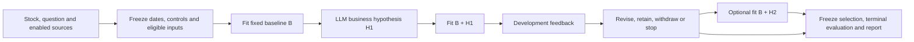

# Fixed controls and business-hypothesis increments

This is the bounded implementation of [RFC #113](https://github.com/natureofnature/Quant_RSI/issues/113)
and its time-window/information-visibility comment. It uses the existing study,
feature execution, selection, terminal evaluation, reports and successful-operation cache.
It does not change the default legacy study or protected recursive evaluator.

## Run one question

```bash
quant-rsi research-study KO \
  --research-mode incremental \
  --question "Does inventory growth relative to revenue add information beyond price controls?" \
  --financials --historical-sessions 252 --llm codex \
  --output /tmp/ko-incremental-business
```

Codex uses the existing CLI login. The existing API, DeepSeek and Cursor transports
also use the incremental response contract. For offline wiring, use
`--llm simulated --prices synthetic --news simulated --related simulated` and omit
`--historical-sessions`. Offline results are fixtures, not evidence about KO.
The CLI-created run uses the same live UI and HTML/Markdown reports. The workbench
form does not yet expose the new mode or date controls.

The loop is:



The fixed controls are 10-session momentum, 10-session log-return volatility and,
when available, one 10-session target-minus-peer return. The peer is chosen by
sorted configured symbol ID before scoring; it is not an industry benchmark.
Exact IDs, definitions and order are saved in `incremental_plan.json`.

LLM selections contain only up to two business increments. The engine prepends
the controls. In this slice, increments are runnable financial/industry inputs
already supplied by the enabled data adapters, or the existing bounded business
expressions over those inputs. New price recipes and news-count recipes are not
part of this mode's candidate domain. Current news can motivate the hypothesis;
it cannot substitute for a missing business measurement.

For example, `inventory_yoy - revenue_yoy` measures relative growth. It is neither
inventory turnover nor a direct measurement of demand. Existing financial
coverage reports retain source periods, missing values and distinct training /
development values. Repeating quarterly values over daily rows does not create
independent financial observations. A constant feature is still identified as
such; feature presence alone is not useful information or predictive gain.

Every admitted input must be usable on **all** frozen training and development
rows. There is no per-candidate row dropping, filling, or retrospective reduction
of the baseline population. Unavailable candidate proposals are recorded and
stop the run with the current incumbent. Source gaps remain visible. With no
eligible business inputs, a baseline-only report is a valid outcome.

## Budget and decisions

Incremental mode defaults to three research fits: **B, B+H1 and optionally B+H2**.
`--rounds` and `--max-fits` include the baseline; either may reduce the allowance
to two, and neither may exceed three. The first LLM call receives the baseline's
development feedback, and the revision sees completed development attempts.

- `test`: evaluate a distinct executable increment; strict improvement on the
  preselected MAE or Sharpe metric updates the incumbent. Ties retain it.
- `retain` / `stop`: finish with the incumbent, without another fit.
- `withdraw`: discard the business increment and reuse B, without another fit.
- An unchanged recipe set, including renamed identical business expressions,
  causes no fit. The last decision remains in the report even when no prediction follows.

The baseline is fitted once per study. Failed service calls can be continued with
`quant-rsi research-resume PATH`; completed fits and successful hypotheses are
restored from the existing cache. Completed studies remain immutable.

Default financial/industry removal diagnostics are suppressed in this mode,
and daily publication defaults to `--latest-fit selected`. Explicit
`--compare-models`, `--compare-qlib` or `--latest-fit refit` declare additional fits
outside the research allowance in the saved configuration. Fixed-window research
rejects `--walk-forward-folds`; it does not introduce a new rolling trainer.

## Frozen dates and information

Optional `--train-dates START END`, `--development-dates START END` and
`--terminal-dates START END` accept inclusive ISO feature-origin dates within the
retained price calendar. Set enough `--historical-sessions` to cover them. Omitted
ranges retain the existing session-count defaults. Explicit ranges must be
chronological and nonoverlapping; terminal dates conflict with `--terminal-sessions 0`.
Training needs at least 12 mature rows and development at least two.

The engine excludes warm-up origins and boundary rows whose horizon target reaches
or crosses the next partition, and terminal rows whose targets are not retained.
`config.json` saves requested ranges; `research_windows.json` saves actual
origin/target dates, timezone-aware decision closes, horizon and excluded rows.
It is frozen before any scores, shared by every fit and retained on resume.
Learned preprocessing uses training rows only. Development drives selection;
terminal evaluation is performed only after selection and is never revision feedback.

Two information modes are explicit:

| Mode | LLM evidence | Interpretation |
|---|---|---|
| `retrospective` (default) | Current RSS and optional current news research; existing research history | Today's hypothesis evaluated on historical samples. A held-back terminal score alone does not establish historical independence. |
| `retained` | Eligible retained news, enabled financial evidence and development feedback; no current search, guidance extraction or cross-run research memory | Supplied material is restricted to the research cutoff. Pretrained LLM knowledge is not erased. |

For retained mode, add `--information-mode retained`. An optional timezone-aware
`--research-cutoff` must be at or after the last development target close and
before the first terminal origin close. The default is the last development target
close. Real-price runs require an existing `--prices-dir`; current collection is
not a fallback. Peer inputs without retained collections remain unavailable.
`--news-archive` / `--news-snapshot` retain original receipt times; both publication
and receipt must precede the cutoff before an item reaches the LLM. An old article
date cannot make newly received content historical. No eligible material yields
an explicit gap, not current news or a fabricated zero news feature.

Historical news features still use their own per-row receipt cutoff, which is
separate from the research cutoff. Financial features use the existing
publication/version-based historical reconstruction; reporting-period end is
not disclosure time. In retained mode an existing `--financials-dir` snapshot
must also have been received by the research cutoff, or the financial inputs
remain unavailable. Context facts are taken from the development information
boundary, never the latest retained row that may belong to terminal. This does
not authenticate source clocks or prove what a historical trader downloaded.
Retained industry-driver research is currently refused because no corresponding
receipt-proven research view is connected. Configured controls/relationships are
research design inputs, not a claim of historically discovered relationships.

## Inspect the result

The same report now contains fixed controls versus eligible increments, business
hypothesis mappings to fitted columns, MAE deltas against B, strategy/risk metrics,
all fit/no-fit decisions, date boundaries and historical-material gaps. The live
view shows incremental decisions as structured facts and embeds the report.
Negative results and baseline selection are expected possible outcomes.

Deterministic tests exercise actual LightGBM fits, a real business-column revision,
no-op/withdrawal/rejection, missing data, boundary-label exclusion, news receipt
filtering, exclusion of terminal financial context, and continuation after a failed
revision without repeating the first two fits. These are engineering checks, not
independent evidence of investment performance.

## Recorded acceptance (2026-11-03)

A real KO run used 252 retained public daily sessions, issuer financial statements,
original retained RSS, configured CCEP prices and Codex CLI authentication. The
final run completed in 63.29 seconds with two Codex calls and two LightGBM fits:

| Attempt | Training inputs | Development price MAE | Decision |
|---|---|---:|---|
| B | Momentum 10, log-return volatility 10, KO-minus-CCEP return 10 | 1.5007 | Retained |
| B+H1 | The same controls plus inventory YoY minus revenue YoY | 1.6043 | Rejected |
| Revision | Codex chose to stop after the disclosed feedback | No additional fit | Reuse B |

Both fits used 177 training and 20 development observations. Reconstructing each
training matrix from the retained inputs reproduced the actual fit receipt's
input hash. The added business column had four distinct training values; it was
not merely a selected ID or a constant dummy. Baseline MAE remained worse than
the unchanged-price development baseline (1.0460). A 10-observation reserved
terminal evaluation ran after selection; neither its results nor the latest
forecast were revision feedback. These are retrospective execution results, not
independent predictive evidence. A preliminary run before the final prompt
construction cleanup also used two calls/two fits and stopped with the same
negative development comparison; both runs were retained.

A small offline cost comparison used the same synthetic price/news/financial
fixture and isolated history, actual LightGBM, three executions per revision,
and one thread. On this machine, median process wall time was 0.715 s on the
parent revision and 0.693 s in incremental mode. The parent performed two research
fits plus one financial-removal fit; incremental mode performed one baseline plus
two business candidate fits and no removal fit. These sub-second measurements
include interpreter startup and do not establish a reliable speedup or full-suite
improvement. An ordinary supported hypothesis still needs zero source edits: edit
the question/options and run one command. No new framework or data adapter is
required for that change.
