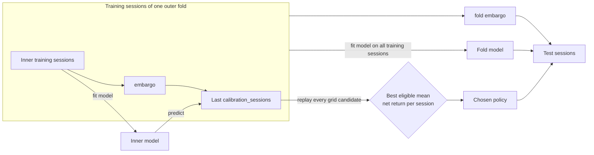
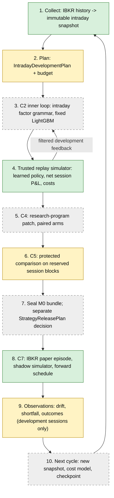
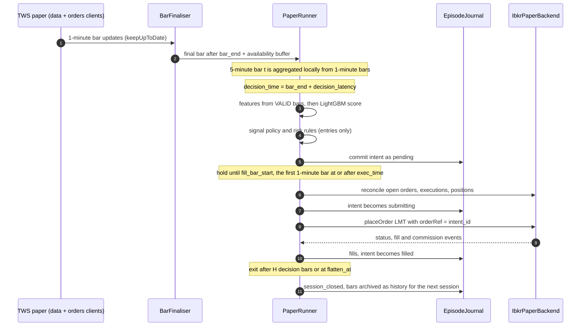
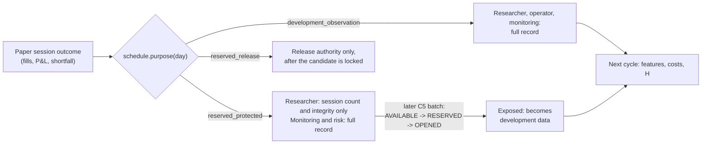
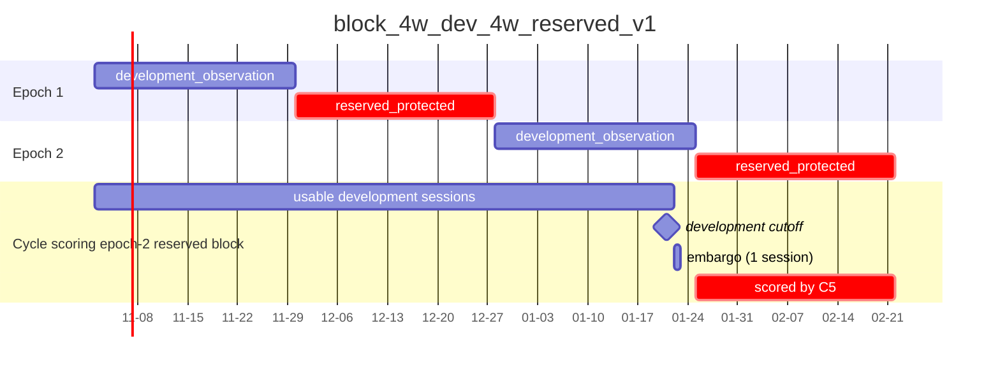

# Intraday Forecasting and IBKR Integration Design

Status: design proposal, 2026-10-29 (revised after first review), branch `intraday`.
A first standalone implementation exists; see the implementation status below.
This proposal extends the [architecture specification](architecture.md). It does not
replace it. Under that specification, high-frequency execution and broker order
placement each need a separately approved capability extension, and this document asks
for that approval for **paper-account** operation only. Live trading with real capital
is out of scope and stays a separate decision.

**Implementation status (2026-10-29).** A standalone, offline-tested first implementation
exists under `src/quant_rsi/brokers/` and `src/quant_rsi/intraday/`; see the
[operating guide](intraday_ibkr.md). It covers:
- the IBKR adapter, paper guard and pacing;
- intraday snapshots and timing, features and the fixed model;
- the learnable trading policy and its nested calibration (section 5.7);
- the replay simulator and development evaluation;
- paper episodes and the forward schedule.

Not yet implemented:
- wiring into the POSIX controller (C2/C4/C5 runs, sealing registry, budget ledger,
  `quant-rsi` subcommands), which needs a Linux environment to build and test;
- the daily `ForecastInputs` envelope with a Yahoo action-notice sidecar;
- the cycle manifest and `next-cycle` linkage.

In this document, **RSI** means *recursive self-improvement*, as in the README. The
technical indicator is always written out as *relative strength index*. It appears only
as a candidate intraday feature.

## 1. Goals

| ID | Goal | Done when |
| --- | --- | --- |
| G1 | IBKR market data for daily and intraday frequencies | Daily and intraday bars from TWS/IB Gateway land in immutable snapshots with recorded availability, sessions and receipts. Existing forecast and research paths can choose `ibkr` as a source next to Yahoo. |
| G2 | Intraday prediction model | A fixed-recipe LightGBM model on an intraday bar grid. It has causal features, same-session labels, day-blocked walk-forward folds, sealing and fixed-model inference. |
| G3 | Simulated trading with IBKR as backend | (a) A deterministic replay simulator that uses IBKR historical bars and quotes. (b) A prospective paper runner that sends orders to an IBKR **paper** account and reconciles the broker's fills against the simulator's expected fills. |
| G4 | Complete RSI cycle for the intraday model | Collect, research (C2), program change (C4), protected comparison (C5), seal, paper observation (C7) and feedback into the next cycle run end to end under budgets. Every step is recoverable and replayable. |

"Complete" in G4 means the engineering loop is closed and verified. Predictive advantage
or a profitable strategy is a separate result; the loop may correctly keep the incumbent.

## 2. Constraints carried over from the current system

- **Point-in-time data.** Every bar records event time, `source_available_at` and the
  first-seen receipt. A historical backfill uses a declared availability assumption. A
  live stream uses `observed_receipts`.
- **Trusted boundary.** Broker connections, market-data credentials and order placement
  stay in the trusted controller/acquisition process. Candidate workers never see a
  socket, client ID or account ID.
- **Separate statuses.** Execution, evidence and promotion statuses stay separate.
  Researcher promotion and strategy release are separate decisions. Paper outcomes are
  `developer_visible_observation`, except on sessions reserved in advance for protected
  use (section 7). A session's outcome never becomes protected evidence after a
  researcher has seen it.
- **Immutable artifacts.** All data is content-addressed. Completed workspaces and their
  source/runtime identities are kept across upgrades.
- **No live account.** Section 4.3 defines an explicit paper-only guard. A live account is
  refused even if a configuration file asks for it.

## 3. Environment and dependencies

### 3.1 IBKR client library

- Source: `C:\TWS API 1050.02\source\pythonclient` (`ibapi` 10.50.x, needs `protobuf==5.29.5`).
- **Licence:** `ibapi` is GPL-3.0-or-later. Do **not** vendor or copy it into this repository.
  Treat it as an optional, locally installed dependency:
  ```bash
  python -m pip install "/path/to/TWS API 1050.02/source/pythonclient"
  ```
- Add an optional extra, `[project.optional-dependencies] ibkr = ["protobuf==5.29.5"]`, and
  document the local `ibapi` install in the README. Pin `protobuf` in
  `requirements-dev.lock` only if CI needs it. CI never needs `ibapi`, because all tests use
  a fake transport (section 9).
- The runtime identity records the `ibapi` version and a SHA-256 of its installed source
  tree, the same way the existing runtime records dependency versions.
- Import `ibapi` lazily, only inside `quant_rsi.brokers.ibkr`. Every other module must
  import and test cleanly without it.

### 3.2 Process layout on this machine

Quant RSI supports only Linux (POSIX locks, signals, rlimits). TWS is installed on Windows.
Recommended setup:

```text
Windows host                                WSL2 Ubuntu (Python 3.12)
┌───────────────────────────┐   TCP 7497   ┌──────────────────────────────┐
│ TWS or IB Gateway (paper) │◀────────────▶│ quant-rsi (trusted process)  │
│ API: Enable, trusted IP   │              │  └─ brokers/ibkr adapter      │
└───────────────────────────┘              └──────────────────────────────┘
```

- Default ports: TWS paper `7497`, TWS live `7496`, Gateway paper `4002`, Gateway live
  `4001`. Only the paper ports are accepted (section 4.3).
- In TWS, under Global Configuration → API → Settings: enable socket clients, and set
  read-only API **off** only for the paper session that places orders.
- WSL2's default NAT networking gives the VM a new IP address after each reboot, which
  breaks a trusted-IP entry. Use mirrored networking instead (`networkingMode=mirrored`
  in `%UserProfile%\.wslconfig`), so Quant RSI connects to `127.0.0.1` and TWS can keep
  "Allow connections from localhost only" enabled.
- IB Gateway on Linux is a valid alternative for unattended runs. Unattended Gateway
  operation needs a login-automation tool such as IBC to handle the daily restart and
  the weekly re-authentication (section 4.1). That tool is outside this repository and
  is recorded in the runtime identity when used.
- Connection settings go in an ignored local file, `.quant_rsi/ibkr.json` (host, port,
  client IDs, expected account). Quant RSI stores no IBKR username or password; TWS
  handles login.

### 3.3 Market-data entitlements

API historical and streaming data need the matching IBKR market-data subscriptions. The
paper account must have the live account's subscriptions shared with it. Delayed data
(`reqMarketDataType(3)`) may be used for development only. Snapshots record it as
`data_entitlement: delayed`, and such snapshots cannot feed a paper release.

## 4. IBKR adapter (`src/quant_rsi/brokers/ibkr/`)

```text
src/quant_rsi/brokers/
    __init__.py
    contracts.py        # Broker-neutral typed contracts (Bar, OrderIntent, BrokerFill, ...)
    ibkr/
        __init__.py
        connection.py   # EClient/EWrapper thread, request-ID futures, reconnect, clock
        guard.py        # Paper-only account and port guard
        pacing.py       # Historical-data pacing limiter with persisted request log
        instruments.py  # Contract qualification, conId binding, trading/liquid hours
        history.py      # Daily and intraday historical bar collection
        stream.py       # Live bars (keepUpToDate / 5-second real-time bars)
        orders.py       # Paper order submission, status, executions, commissions
        transport.py    # Protocol interface; real ibapi and fake implementations
```

### 4.1 Connection

- One `IbkrSession` owns an `EClient` and an `EWrapper` subclass. A reader thread runs
  `EClient.run()`. Callers use a synchronous facade: each request gets a request ID and
  a `Future`, with an explicit timeout. Errors and `error()` callbacks become typed
  failures. The bundled `ibapi/sync_wrapper.py` can be used as a reference, but the facade
  stays project-owned so its timeouts and failure categories are explicit.
- Client IDs are separate by role: `data` (for example 11) and `orders` (for example 21).
  A data collector can then never cancel or see orders it did not create.
- At startup the session records: `nextValidId`, `managedAccounts`, the server version and
  `reqCurrentTime` against `trusted_now()`. Clock skew above a configured bound (default
  2 s) blocks intraday order submission.
- Disconnects (error codes 1100/1101/1102, 504, socket close) are recorded as
  connection events. Reconnecting never replays an order. The order path reconciles
  instead (section 6.3).
- **Planned restarts.** TWS and IB Gateway restart once a day at a configured time and
  require full re-authentication weekly. `.quant_rsi/ibkr.json` records the configured
  restart time. A disconnect inside that window is a `planned_restart` event, not a
  fault. Episodes open no new entries within `restart_guard_seconds` of the window. With
  the v1 flat-overnight policy and a restart time outside regular trading hours, no
  position is open during a restart. An unplanned weekly logout suspends the episode
  until an operator logs in again.

### 4.2 Instrument identity

- An instrument profile names `symbol`, `secType=STK`, `currency`, `exchange=SMART` and
  `primaryExchange`. `reqContractDetails` must resolve to **exactly one** `conId`, and
  that `conId` becomes the stable instrument identity in snapshots. An ambiguous or empty
  result is an error, never a guess.
- `ContractDetails.timeZoneId`, `tradingHours` and `liquidHours` are recorded as evidence.
  They cover only the next few days, so the historical calendar still comes from the
  existing NYSE parser. For forward sessions, the two sources must agree. A disagreement
  blocks paper trading for that session.

### 4.3 Paper-only guard

Order placement is refused unless **all** of these hold:

1. The configuration says `account_mode: "paper"`.
2. The connected port is in `{7497, 4002}`, or in an explicitly configured paper-port set.
3. Every account in `managedAccounts` starts with `DU`, IBKR's paper prefix for
   individual accounts, and the expected account ID in `.quant_rsi/ibkr.json` matches.
   Financial-advisor paper structures (`DF` master accounts) are deliberately rejected
   in v1.
4. The `orders` client ID matches the configuration, and the episode is registered as a
   paper episode.

Any failure stops the episode with `live_account_refused` before an order intent is
persisted. The code has no switch that disables this guard. Live trading would need a new
module and a separate approval.

### 4.4 Historical data pacing

IBKR documents these hard limits for bars of 30 s or shorter:
- no identical request within 15 s;
- no more than 6 requests for the same contract, exchange and tick type within 2 s;
- no more than 60 requests in any 10-minute window;
- bars of 30 s or shorter are unavailable when older than about 6 months.

Larger bars have softer, load-dependent limits. Separately, no more than 50 historical
requests may be open at once.

`pacing.py` applies the hard limits conservatively to **every** bar size (default 50
requests per 10 min, 1 request per contract per 3 s, at most 10 open requests). It keeps
a request log in SQLite so that restarts respect the window. Error 162 (pacing
violation) triggers a backoff. That request is recorded as failed and is not counted as
data.

### 4.5 Historical collection (`history.py`)

| Frequency | Request | Notes |
| --- | --- | --- |
| Daily | `barSizeSetting="1 day"`, `whatToShow="TRADES"`, `useRTH=1`, `formatDate=1` | Raw, unadjusted prices, matching the existing `price_basis: raw`. `ADJUSTED_LAST` is not used. |
| Intraday | `barSizeSetting="1 min"`, `whatToShow="TRADES"`, `useRTH=1`, `formatDate=2` (UTC epoch) | Requested in chunks of one trading day. `reqHeadTimeStamp` bounds the earliest request. Only the 1-minute execution grid (section 5.3) is requested; decision bars are aggregated locally from it, which saves a third of the requests. Stored responses are indexed by request digest, so collection resumes after interruption. |
| Intraday quotes (optional) | `whatToShow="BID_ASK"` with the same grid | Supplies average bid/ask per bar for spread and cost estimates in the simulator. |

- IBKR's bar timestamp is the **bar start**. The adapter computes `bar_end = start +
  bar_seconds`, clipped to the session close for a shortened final bar. It rejects bars
  outside the registered session.
- Historical availability: `assumed_historical_availability` with
  `available_at = bar_end + availability_buffer_seconds` (default 5 s for intraday bars,
  900 s for daily bars, matching `CLOSE_BUFFER_SECONDS`). The snapshot carries this as an
  explicit assumption, not as point-in-time certification. Plan validation checks the
  plan's `ExecutionTiming` against the contract and requires
  `decision_latency_seconds >= availability_buffer_seconds` (section 5.3). Paper
  episodes measure whether live data meets this assumption (section 4.6).
- **Missing bars.** IBKR returns no `TRADES` bar for an interval with no trades, and a
  trading halt leaves a run of empty intervals. The normaliser places every bar on the
  registered grid and marks absent intervals `missing`. It never forward-fills a bar or
  invents a zero-volume, zero-return bar. Section 5.3 defines what missing bars mean for
  features, labels and fills.
- Each raw response (list of `BarData` plus the request parameters) is stored byte for
  byte as an artifact before normalisation, as with `yahoo_chart_raw.json` today.
- Corporate actions: the TWS API has no reliable corporate-action feed. IBKR daily
  snapshots declare `corporate_action_coverage: "unknown"`. An optional sidecar can attach
  the existing Yahoo dividend/split notices with their own source identity. Intraday
  research treats a session that contains a known split as ineligible, never as a price
  jump.

### 4.6 Live streaming (`stream.py`)

- Main path: `reqHistoricalData(..., endDateTime="", keepUpToDate=True)` on the
  registered bar size. Partial bar updates are never fed to the model.
- **Finalisation is by the clock**, not by the arrival of the next bar's update. That
  arrival depends on IBKR's update cadence and, for thinly traded instruments, may never
  happen. At `bar_end + availability_buffer_seconds` the stream finalises bar `t` from
  the last update received, if the stream delivered an update within the expected
  cadence. A bar with no update by then is final as `missing` when the stream is
  otherwise current. If the stream itself is silent, the result is `stale_feed`
  (below), not a missing bar.
- A later update for an already-final bar is recorded as a revision. It never changes a
  decision that was already made.
- Fallback path: `reqRealTimeBars` (5-second bars, `TRADES`), aggregated to the
  registered bar size by a trusted, tested aggregator.
- Every final bar becomes a `SourceEvent`-style receipt with `observed_receipts`. Its
  `first_seen_at` is the local trusted clock when the bar became final.
- Stale data (no stream message within `bar_seconds + max_lag_seconds`) produces a
  `stale_feed` event. The paper runner (section 6) then stops opening new risk.
- **Availability check.** Every paper episode records, for each bar, the arrival delay
  `last_update_received_at - bar_end`. The episode report shows that delay's
  distribution. If its registered high quantile (default p99 over the last 5 sessions)
  exceeds `availability_buffer_seconds`, the episode is flagged
  `availability_assumption_violated`. The historical backfill then assumed faster data
  than the live feed delivers. The next cycle must register a larger buffer and
  decision latency; existing snapshots are not relabelled.

## 5. Data contracts and the intraday model

### 5.1 Contract changes

`DataContract.frequency` is currently `Literal["daily_equities"]`. Add a separate model
instead of widening the existing one, so stored daily contracts keep the same digest:

```python
class IntradayGrid(StrictModel):
    bar_seconds: Literal[60, 300]               # Decision grid.
    execution_bar_seconds: Literal[60]          # Execution price grid (section 5.3).
    session_scope: Literal["regular_trading_hours"]
    bar_timestamp: Literal["bar_start"]
    final_bar_policy: Literal["clip_to_session_close"]
    missing_bar_policy: Literal["explicit_missing_no_fill_forward"]

class IntradayDataContract(StrictModel):
    schema_version: Literal[1]
    source_id: Identifier
    provider: Literal["ibkr_tws_api"]
    provider_statement: str
    frequency: Literal["intraday_equities"]
    grid: IntradayGrid
    calendar: CalendarSpec                 # Existing daily sessions; bars subdivide them.
    instruments: tuple[InstrumentBinding, ...]   # symbol + conId + primaryExchange
    knowledge_basis: KnowledgeBasis
    availability_buffer_seconds: int
    data_entitlement: Literal["realtime", "delayed"]
    quote_fields: Literal["trades", "trades_and_bid_ask"]
    corporate_action_coverage: Literal["unknown", "sidecar_notices"]
```

The data contract describes only the data. Latency and fill-window choices are
execution parameters, so they live in the plan and the sealed bundle (section 5.3).
Changing one never changes a snapshot's identity or forces a recollection.

`ForecastWorkflowConfig.source` gains `"ibkr_daily"`. Daily IBKR collection produces the
same `ForecastInputs` envelope shape as Yahoo. However, the existing five-session
objective uses `unknown_action_policy: "affected_or_unknown_interval_abstain"`, and IBKR
supplies no corporate-action notices. A pure IBKR envelope would therefore declare
unknown action coverage, and the forecast could abstain on every interval. P2 resolves
this explicitly:

- **Default:** attach the existing Yahoo dividend/split notices as a separate sidecar
  source with its own identity, receipts and qualifications. IBKR prices plus Yahoo
  notices is a declared two-source envelope, not an IBKR-only one.
- **Alternative:** run IBKR-only with unknown coverage and accept the abstention outcome.
  This is recorded as such and never treated as "no actions occurred".

The five-session recipes, enhanced comparison, factor discovery and recursive
exploration paths then consume the envelope through their existing interfaces. P2 must
show this with fixtures rather than assume it.

### 5.2 Storage

At 1-minute frequency, one year is about 98,000 bars per instrument, too many for the
JSON event rows used today. Store **content-addressed raw column blocks**, one per
instrument, grid and session:

- Each column is canonical little-endian bytes (`<f8` for prices, `<i8` for volume and
  epoch seconds, `|u1` for the bar status: valid, missing or invalid). There is no
  container format.
- A canonical JSON manifest records each column's dtype, shape and SHA-256, together with
  the contract, receipts and availability.

Do **not** use `np.savez`. Its zip container embeds write timestamps, so identical data
would get different digests. Writing and reading these raw blocks needs only NumPy.
SQLite stores only metadata and receipts.

### 5.3 Decision, execution and label timing

A decision bar ends exactly when the next one starts (`bar_end[t] == bar_start[t+1]`). A
decision made after bar `t` closes therefore **cannot** trade at the open of bar `t+1`:
that price is already in the past. Execution uses a separate, finer price grid (1-minute
bars), and labels use the same price rule as fills.

The timing parameters form an `ExecutionTiming` record. It is part of
`IntradayDevelopmentPlan`, it is sealed into the strategy bundle, and the replay
simulator and the paper runner both use it:

```python
class ExecutionTiming(StrictModel):
    decision_latency_seconds: int    # Must be >= the contract's availability_buffer_seconds.
    order_latency_seconds: int
    max_fill_delay_seconds: int
```

For decision bar `t`, inside one session:

- **Decision time:** `decision_time[t] = bar_end[t] + decision_latency_seconds`. Plan
  validation requires `decision_latency_seconds >= availability_buffer_seconds`, so bar
  `t` itself is available at the decision. Defaults: buffer 5 s, decision latency 10 s,
  which includes inference time. Features may use only bars with
  `available_at <= decision_time[t]`.
- **Execution time:** `exec_time[t] = decision_time[t] + order_latency_seconds`
  (default 1 s).
- **Fill bar:** `fill_bar_start[t]` is the start of the first 1-minute execution bar with
  `start >= exec_time[t]`. On 5-minute decision bars this delays entry by just under a
  minute, because the 1-minute bar covering `exec_time` has already started. The delay
  is deliberate, since that bar's open is also already past. **Both** the simulator and
  the paper runner act at `fill_bar_start` (section 6.2), so backtest and paper trading
  run the same strategy.
- **Execution price:** `px(t)` is the open of the first **valid** execution bar starting
  in `[fill_bar_start[t], fill_bar_start[t] + max_fill_delay_seconds]` (default 120 s).
  If there is none, the order is cancelled unfilled. 1-minute bars have multi-year
  history, unlike 5-second bars, so the same rule applies across the whole research
  window.
- **Label:** `y[t] = px(t+H) / px(t) - 1`, with `H` in decision bars
  (default `H = 6`, 30 minutes on 5-minute bars). The label is exactly the return of
  entering at bar `t`'s fill price and exiting at bar `t+H`'s fill price under the
  same latency. A label exists only if both prices exist in the **same session**. Labels
  never cross the overnight gap.
- **Maturity:** in M1 or prospective training, a label counts as mature at the
  `available_at` of the execution bar that supplies `px(t+H)`.
- **Flatten rule:** `flatten_at = session_close - flatten_offset_seconds`, computed per
  session so early closes are handled. A decision bar may open a position only if
  `fill_bar_start[t+H] <= flatten_at`. Positions are closed at the open of the first
  valid execution bar starting at or after `flatten_at`. Overnight inventory is disabled
  in v1 (`overnight_policy: "flat"`).
- **Missing bars:**
  - A feature whose window contains a missing bar is missing. It is not computed over a
    shortened window.
  - A label whose entry or exit price is missing does not exist.
  - An order whose fill window has no valid execution bar is cancelled unfilled.
  - **Halt rule (target instruments, decision grid).** A **traded** instrument with more
    than `halt_missing_bars` consecutive missing **decision-grid** bars (default 3,
    15 minutes on 5-minute bars) is ineligible for new entries for the rest of the
    session. A position it already holds exits at the first valid execution bar after
    trading resumes. That exit is marked `halt_delayed_exit`, and the replay never
    invents an exit price during the halt.
  - **Context instruments** (for example XLP or SPY used only as features) never halt
    the strategy. Their leaves follow the feature rule above, with a registered
    `context_missing_tolerance` (default 0 missing bars per leaf window). Sparse 1-minute
    ETF bars therefore reduce coverage visibly, which section 5.5 handles, rather than
    being silently filled in.

### 5.4 Features (fixed recipe v1 and grammar leaves)

All features are trailing and computed per instrument from final bars only:

| Group | Leaves |
| --- | --- |
| Returns | log return over k bars, k ∈ {1, 3, 6, 12} |
| Volatility | realised volatility over 12/24 bars; high-low range / close |
| Volume | volume z-score against the same time-of-day bar over the previous 20 sessions |
| Price location | deviation from session VWAP; distance from opening-range high/low |
| Session context | minutes since open; overnight gap `open[session] / close[prev session] - 1` |
| Oscillator | relative strength index (Wilder, 14 bars), scaled to [-1, 1] |
| Cross-asset | SPY and industry-ETF k-bar returns on the same grid (same conId binding rules) |
| Daily context (optional) | last sealed daily forecast, as of the previous close only |

Same-time-of-day statistics use only earlier sessions. Any leaf whose lookback goes past
the session open uses the previous session's bars only if
`allow_cross_session_lookback: true` is registered. The default is false; leaves are
missing until the warm-up completes.

### 5.5 Model, folds and evaluation

- **Model:** the same fixed LightGBM regression recipe as `core/model.py`
  (`num_threads=1`, `deterministic=True`, registered seed). The target is `y[t]`. Model
  search stays out of scope (C3).
- **Folds:** walk-forward with boundaries on **session boundaries**. Labels never cross a
  session, so a fold boundary needs no intra-session purge. An optional embargo of
  `embargo_sessions` (default 1) is registered. Dependence clusters are whole sessions,
  and uncertainty uses block resampling over sessions.
- **Signal to position:** long-only in v1. Go long when the score clears the entry
  hurdle, exit when the score falls below `exit_threshold`, after `H` decision bars, or
  at `flatten_at`, whichever comes first. The hurdle, the size and both thresholds are
  set by the trading policy, which can be learned (section 5.7). The architecture
  specification calls for an explicit long-only start; short selling is a later
  registered extension.
- **Missing predictions.** The existing `predict_fixed` raises on any non-finite feature.
  The intraday path does not pass missing values to the model and does not convert them
  to cash:
  - A row with any missing required feature is recorded as `no_prediction`, with the
    missing leaves as the reason. The model is not called for that row.
  - A `no_prediction` row opens no new position. A position already held still follows
    the time-based (`H` bars) and `flatten_at` exits. It is not exited or extended
    because a prediction is missing.
  - Prediction coverage (scored rows / eligible decision bars) is reported per fold and
    per session. A candidate below the registered `min_prediction_coverage` (default
    0.9) in any fold is **ineligible**, so a factor cannot look good by trading only on
    its easy bars.
  - The same rules apply in the paper runner. Coverage is one of its monitored
    quantities.
- **Known limitation:** score-based and flatten exits can end a trade before `H` bars,
  so the realised holding period can be shorter than the label horizon the model was
  trained on. The simulator reports the realised holding-period distribution next to
  the results. A holding-period-matched label is a candidate C4 change, not part of v1.
- **Authoritative metrics** come from the trusted replay simulator (section 6.1), not
  from the worker:
  - net P&L per session;
  - turnover and cost share;
  - hit rate;
  - realised holding period.

  Rank IC is a diagnostic only.
- **Development ranking metric** (`IntradayDevelopmentPlan`, used by C2 and C4
  development selection): median across folds of mean net return per session, in bps.
- **Eligibility:** a candidate with fewer than the registered minimum number of trades
  in any fold is **ineligible** for ranking. This is a candidate-validity outcome, not an
  evidence status.
- **Protected comparison utility** (C5, as defined in the architecture specification):
  annualised arithmetic mean net active return against the registered **flat-cash
  benchmark** (zero-interest cash, the investable intraday reference), weighted by the
  TaskWeightManifest. `insufficient_evidence` comes only from that comparison's
  registered uncertainty rules. The development ranking metric is never reused as the
  protected utility.
- **Annualisation, registered with the plan:**
  - The unit of observation is one registered session.
  - A session's return is that session's net P&L, including costs and the forced
    flatten, divided by the episode capital at the session open.
  - Sessions with no trades count as zero-return observations. They are not dropped.
  - Early-close sessions count as one full session; the shorter trading window is not
    rescaled.
  - Annualised utility = `252 × mean(session_return − benchmark_session_return)`, where
    252 is the registered NYSE sessions-per-year convention. With the flat-cash
    benchmark, the benchmark session return is zero.

### 5.6 Sizes and bounds

Add an `IntradayDataSpec` with its own bounds rather than reusing C2's 24–1000 sessions:
- 20–750 sessions;
- 1–10 instruments;
- at most 400 bars per session;
- a total row limit per job, for example 2,000,000 instrument-bars.

Workers get a memory limit to match. Larger runs need a new registered plan.

### 5.7 Learnable trading policy

The model predicts the `H`-bar forward return; it does not trade. A **trading policy**
turns each finite prediction into an entry quantity, or no entry. Intraday strategies
usually lose more to costs than to bad predictions, so the policy's main job is to decide
when **not** to trade and how much to risk. v1 makes that policy learnable with a small,
registered parameter grid rather than a separate policy model.

**Why not an end-to-end policy model.** A reinforcement-learning or directly
P&L-optimised policy has far more free parameters than one year of 5-minute bars (about
20,000 decisions per instrument) can constrain, and P&L rewards are noisier than return
labels. It would learn the backtest. It would also break the guarantee that the replay
simulator and the paper runner trade the same strategy. It may be revisited once a simple
policy has shown a profit on reserved sessions and much more data is available.

**Policy fields** (`SignalPolicy`, sealed with the strategy):

| Field | Values | Meaning |
| --- | --- | --- |
| `entry_rule` | `fixed_threshold` (default), `net_of_cost` | Hurdle is `entry_threshold`, or `entry_threshold` plus the estimated round-trip cost |
| `entry_threshold`, `exit_threshold` | Returns | Entry margin and early-exit level; `exit_threshold <= entry_threshold` |
| `sizing` | `fixed_fraction` (default), `edge_scaled` | Full `notional_fraction`, or scaled by how far the score clears the hurdle |
| `full_size_edge` | Return in (0, 1] | `edge_scaled` only: the edge above the hurdle that earns the full size |

The defaults reproduce the earlier fixed policy exactly.

**Entry rule** (`policy.entry_quantity`, called by both the simulator and the paper
runner, using only the score, the decision bar's close and the session's starting
equity):

1. `full = lots(equity × notional_fraction / close)`. If `full` is 0, the entry is
   cancelled, as before.
2. `round_trip_cost(q) = 2 × commission(q) / notional(q) + assumed_spread_bps / 10⁴`:
   IBKR per-share commission with its minimum and cap on entry and exit, plus one full
   assumed spread. It is an estimate for the full order at the decision bar's close: a
   fill reduced by the participation cap pays a larger commission share than estimated,
   and the actual spread can differ from `assumed_spread_bps`.
3. `hurdle = entry_threshold`, plus `round_trip_cost(full)` under `net_of_cost`. If
   `score <= hurdle`, the policy declines.
4. Under `edge_scaled`, `q = lots(full budget × min(1, (score − hurdle) / full_size_edge))`.
   A smaller order pays a larger commission share, so the hurdle is checked again at `q`.
   If `q` is 0 or the check fails, the policy declines.

A declined entry is recorded (`policy_declined_entries` in the simulator,
`entry_declined` in the paper journal); it is not a cancelled order.

**Policy search** (`IntradayDevelopmentPlan.policy_search`, optional):

```python
class PolicySearch(StrictModel):
    entry_thresholds: tuple[float, ...]   # 1-8 values
    exit_thresholds: tuple[float, ...]    # 1-8 values; pairs with exit > entry are skipped
    full_size_edges: tuple[float, ...]    # searched exactly when sizing is edge_scaled
    calibration_sessions: int             # 5-250
    min_calibration_trades: int
```

- The grid holds at most 64 candidates, in registered order. `entry_rule` and `sizing`
  are declared, not searched.
- `H` is **not** searched. Changing `H` changes the label, so it is a model change and
  stays a declared C4 intervention.
- The plan's `signal` is the fallback when no candidate is eligible.
- Plan validation checks that the first (smallest) fold's training block holds the
  calibration sessions, the embargo before them and at least one inner training session.

**Nested calibration** (`calibration.choose_policy`). The policy is learned inside each
training block, so it never sees the sessions it is scored on:



1. Split the training block: the last `calibration_sessions` are held out, and the inner
   training sessions end `embargo_sessions` before them.
2. Fit the fixed LightGBM recipe on the inner sessions and predict the calibration
   sessions.
3. Replay every candidate on those predictions with the trusted simulator.
4. A candidate is eligible if it has no unresolved session and at least
   `min_calibration_trades` round trips. The eligible candidate with the highest mean net
   return per session wins; ties go to the earlier candidate. With none eligible, the
   declared `signal` is used and recorded as `declared_fallback`.
5. The fold's model is then fitted on the whole training block, as before, and its test
   sessions are replayed with the chosen policy.

Each fold report records the source (`declared`, `calibrated`, `declared_fallback`), the
chosen policy fields, the calibration sessions and every candidate's calibration result.

**Known limitation.** The policy is chosen on predictions from the inner model, but trades
on predictions from the model fitted on the whole training block. Both predict the same
return, so the thresholds keep their meaning, but the spread of predictions can differ.
Evaluation uses exactly this procedure, so each fold's test result already includes the
effect; it is not hidden.

**Final fit.** `fit` runs the same procedure with the whole snapshot as the training
block: it learns the policy on the snapshot's last `calibration_sessions`, fits the final
model on all sessions, and prints the chosen `signal` with its SHA-256 (optionally
writing it with `--policy-output`). The paper plan registers that `signal` together with
`signal_sha256`. A plan whose `signal` does not match its digest is refused, so the policy
cannot be edited by hand after `fit`, just as the model is checked against
`model_sha256`.

**Selection-bias controls.**
- The grid is small and registered before any calibration.
- The policy is learned only from sessions inside the training block, so each fold's test
  result is an out-of-sample estimate of the whole procedure (model plus policy).
- Every candidate's calibration result is reported, not just the winner's.
- The C5 protected comparison scores the sealed model and policy together on reserved
  sessions, under the temporal ordering rule (section 7).

## 6. Simulated trading

There are two backends with one interface, so the evaluator, the paper runner and the
reports share the same accounting.

```python
class ExecutionBackend(Protocol):
    def submit(self, intents: Sequence[OrderIntent]) -> Sequence[SubmissionReceipt]: ...
    def poll(self, until: datetime) -> Sequence[BrokerEvent]: ...   # status, fills, fees
    def cancel(self, intent_ids: Sequence[str]) -> Sequence[BrokerEvent]: ...
    def reconcile(self) -> ReconciliationReport: ...
```

### 6.1 Replay simulator (deterministic, historical)

- This extends `execution/execution_account.py`, keeping its cash, lot, reservation and
  half-even rounding rules and adding an intraday fill model:
  - `fill_policy: "first_execution_bar_open_after_latency"`, with the reference price
    `px(t)` (section 5.3);
  - **spread handling, chosen explicitly in the plan:**
    - `spread_policy: "mid_plus_half_spread"` (default when `BID_ASK` bars exist): the
      fill is the bid/ask midpoint of the fill bar ± half its spread. IBKR's `BID_ASK`
      bars report the time-averaged bid as `open` and the time-averaged ask as `close`.
      This avoids double-counting the spread on top of a trade price.
    - `spread_policy: "trade_open_plus_half_spread_conservative"` (when only `TRADES`
      exists): the fill is the trade open ± half of a registered `assumed_spread_bps`.
      A trade open may already be at the bid or the ask, so this rule deliberately
      overstates cost. Reports label it conservative;
  - slippage and impact are linear in bps with a participation cap of `fill_cap_fraction`
    times bar volume;
  - IBKR tiered or fixed commission tables are explicit inputs with a minimum per order
    (new `cost_policy: "ibkr_fixed_per_share"`).
- Forced flatten at `flatten_at`. If no valid execution bar is left before the session
  close, the position is `unresolved`, never given a fictional exit price.
- The simulator is the **trusted evaluator** for development and C5 scoring. Its
  fixtures include hand-calculated intraday cases (section 9).

### 6.2 IBKR paper runner (prospective)

This is a new `execution/intraday_paper.py`, built on the existing observer's journal,
CAS checkpoints and step semantics.

1. **Register an episode:**
   - sealed bundle, `IntradayDataContract` and account rules;
   - expiry, max model age and max information age;
   - paper-guard binding and the `ForwardSessionSchedule` (section 7).

   Activation time is recorded after commit. Feature warm-up uses the bound snapshot's
   history, read through the same as-of view, so the first prospective bar can be
   scored. Only bars received after activation are prospective observations. Warm-up
   history is never reported as forward performance.
2. **For each final bar:**
   - persist the receipt;
   - run fixed-model inference with the existing `predict_fixed` path on the intraday
     view;
   - persist the prediction;
   - compute target positions;
   - persist **order intents**, each with:
     - an idempotency key `episode:session:bar:instrument:side`;
     - a scheduled submission time `submit_at = fill_bar_start[t]` (section 5.3);
     - a **submission deadline**
       `submit_deadline = fill_bar_start[t] + max_fill_delay_seconds`;
   - hold each intent until `submit_at`, then submit.

   Submitting at `fill_bar_start`, not at `exec_time`, makes the paper order act at the
   same moment the simulator fills. The shadow comparison (section 6.4) then measures
   execution quality, not a ~50 s timing difference. An intent that is not confirmed as
   submitted (an `openOrder` or `orderStatus` with its `orderRef`) before
   `submit_deadline` is never sent afterwards. Any working remainder is cancelled at the
   deadline. This keeps paper fills inside the same window the simulator allows.
3. **Order construction:** `Order.orderRef = intent_id` and `Order.account = <DU
   account>`. Use a marketable limit order (limit = last bar close ± `limit_offset_bps`),
   `tif="DAY"`, `outsideRth=False`. Market orders can be enabled by configuration, but
   are off by default.
4. **Events:** `orderStatus`, `openOrder`, `execDetails` and
   `commissionAndFeesReport` are appended as broker events. Fills are keyed by `execId`,
   so a duplicate callback after reconnect is ignored.
5. **Flatten:** at `flatten_at` the runner cancels working orders and sends closing
   orders. At session close + buffer, any remaining position is recorded as
   `overnight_breach`, which suspends the episode.

### 6.3 Episode ledger, recovery and reconciliation

**Episode-scoped accounting.** An IBKR paper account usually starts with a large default
balance (often 1,000,000 USD) and may hold other activity. The broker account balance is
therefore **not** the episode's capital.

- Each episode has a **virtual sub-account**: its registered capital (for example
  100,000 USD), plus only the orders and fills whose `orderRef` carries the episode's
  prefix.
- Cash, P&L and risk limits are computed from that ledger only.
- At registration, the runner checks that the broker account's available funds cover
  the episode capital. It also checks that the account holds **no** position in any
  episode instrument. If the account holds one, registration is refused, because the
  runner could not attribute those shares to the episode.
- **One active episode per paper account,** with no manual trading in that account. This
  is a documented operating requirement, not a hidden assumption. Registration is
  refused if another episode is active on the same account. Most IBKR users have a
  single paper account, so the default deployment runs one episode at a time
  (section 7). Running two episodes at once requires a second configured paper account.

**Recovery.**

- Before every submission and after every reconnect, the runner calls:
  - `reqOpenOrders`;
  - `reqCompletedOrders`;
  - `reqExecutions(ExecutionFilter(clientId, acctCode, time=session_start))`;
  - `reqPositions`.

  It matches broker records to intents by `orderRef`.
- `reqExecutions` returns only the current day's executions, and TWS restarts daily.
  Recovery after a day boundary therefore relies on the local journal of committed
  `execDetails` events. A prior-day intent with no committed terminal event is marked
  `unresolved_prior_day` and blocks new risk until an operator resolves it. It is never
  assumed filled or unfilled. The flat-overnight policy keeps this case rare.
- An intent that is persisted but has no broker record and whose `submit_deadline` has
  passed is marked `abandoned_unsubmitted`. It is never re-sent late. This mirrors the
  existing `abandon_unconfirmed` rule.
- **Position check:** the episode ledger's positions are compared with broker positions
  **for the episode's instruments only**. If they differ, the episode is suspended
  (`position_mismatch`) and opens no new risk. Recovery is manual and recorded.

### 6.4 Shadow comparison

Every paper fill is paired with the replay simulator's fill for the same intent, using
the same bars. The episode records:
- per-fill implementation shortfall: paper price against simulated price, in bps;
- the fill-rate difference;
- the fee difference.

These numbers measure how optimistic the simulator's cost model is. On
`development_observation` sessions they are developer-visible and may feed the next
cycle's cost assumptions (section 7, step 9). On reserved sessions they go to monitoring
only.
IBKR paper fills are themselves simulated by IBKR and do not prove live execution
quality.

### 6.5 Risk controls (paper)

Hard limits that stop new entries are:
- maximum gross notional;
- maximum position per instrument;
- maximum orders per minute;
- maximum daily loss (bps of capital);
- maximum consecutive rejects;
- clock skew;
- stale feed;
- expired model.

The `observer stop` semantics carry over: stop is a durable intent, and
`queue_exit_at_next_eligible_bar` closes positions with real later fills. The exit uses
the same fill-bar and execution-price rule as any other order (section 5.3): it submits
at the next `fill_bar_start` after the stop is committed, within `max_fill_delay_seconds`.

## 7. The intraday RSI cycle (G4)

One cycle turns new market data into a better researcher, a better strategy, or both,
and then produces the data the next cycle learns from. Colours show what the standalone
implementation covers today.



| Colour | Meaning |
| --- | --- |
| Green | Implemented: `collect`, replay `simulate`/`evaluate`, paper runner and live loop |
| Yellow | Partly implemented: the plan without the budget ledger, the schedule and temporal-ordering check without the C5 batch, shadow and availability reports without drift monitors |
| Grey, dashed | Needs the POSIX controller: C2 and C4 runs, sealing, the cycle manifest |

The cycle has two time scales. The outer loop (steps 1–10) runs once per cycle, over
weeks. Step 8 contains an inner loop that runs every decision bar of every paper session:



The same timing rule drives the replay simulator in step 4, so the backtest and the
paper episode trade the same strategy (section 5.3).

| Step | Reuses | New work |
| --- | --- | --- |
| 1 Collect | Receipts and artifacts from `daily_data.py`, NYSE calendar | `brokers/ibkr/history.py`, raw column blocks, `IntradayDataContract` |
| 2 Plan | `DevelopmentPlan`, budget ledger | `IntradayDevelopmentPlan` (grid, H, folds, thresholds, costs, bounds) |
| 3 C2 | `factors/discovery.py` frontier, journal, worker | Intraday leaf catalog (section 5.4), intraday feature view and mask |
| 4 Evaluate | `execution_account.py` accounting | Intraday fill and cost model, session-flat accounting, session-block metrics |
| 5 C4 | `research/package_experiment.py`, trajectory | Patch targets: leaf set, H, policy rule and search grid, frontier policy (allowlisted fields only) |
| 6 C5 | `evaluation/protected_scoring.py`, evidence ledger | Reserved session blocks; TaskWeightManifest by session mass |
| 7 Seal | `execution/baseline.py` | Intraday bundle fields (grid, execution grid, latencies, H, flatten rule, cost model version) |
| 8 Paper | Observer journal, CAS checkpoints, stop semantics | `intraday_paper.py`, `brokers/ibkr/orders.py`, stream, guard, `ForwardSessionSchedule` |
| 9 Observe | Report and replay | Drift monitors (feature PSI, score distribution), shortfall reports, purpose-filtered views |
| 10 Next | `ResearchStateCheckpoint`, trajectory | Cycle manifest that links prior cycle, new snapshot, schedule and recorded exposure |

#### Forward session schedule (keeping protected data fresh)

Paper trading runs on every session. If every paper session became developer-visible,
cycle 2 onwards would have no unseen sessions left for C5, and the cycle could not
repeat. Each cycle therefore registers a `ForwardSessionSchedule` **before** its paper
episode activates. The schedule assigns every future session, by a rule fixed in
advance, to one of three purposes. The default rule, `block_4w_dev_4w_reserved_v1`,
repeats an 8-week **epoch**: 4 contiguous development weeks followed by 4 contiguous
reserved weeks.

| Purpose | Default assignment | Who sees paper outcomes |
| --- | --- | --- |
| `development_observation` | Weeks 1–4 of each epoch | Researcher, operator, monitoring |
| `reserved_protected` | Weeks 5–8 of each epoch | Monitoring and risk controls only, until a later C5 batch opens them |
| `reserved_release` | Optional; a declared contiguous block after the strategy's selection cutoff | Release authority only, after the candidate is locked |

How a paper outcome reaches each reader (`researcher_view` in `schedule.py`):



An example schedule, anchored on Monday 2026-11-02 with `embargo_sessions = 1`
(holidays omitted). A cycle that will score the epoch-2 reserved block may develop only on
sessions up to the cutoff. The last development session before the block is the embargo
gap:



"Usable development sessions" means the `development_observation` sessions in that span,
plus any reserved sessions an earlier C5 batch has already opened. `development_cutoff`
computes this list, and `validate_temporal_order` rejects a batch that breaks it.

- The assignment rule depends only on the calendar, never on outcomes. It is registered
  with the cycle and cannot be edited afterwards.
- **Temporal ordering rule.** A protected batch (C5) or a release evaluation may score
  only sessions that come **after** every session the compared arms or the candidate
  strategy used for training, development feedback or selection, plus a registered gap
  (`embargo_sessions`, default 1). Without this rule, a later cycle could develop on
  development sessions that come after the reserved sessions it is scored on. The
  candidates and model fits would then reflect data from after the scored period.
  Consequences:
  - A cycle that will score reserved block `k` sets its **development cutoff** to the
    end of the development block immediately before block `k`. Development sessions
    after that cutoff are unavailable to that cycle, even though they were already
    observed.
  - Contiguous development and reserved blocks make this cutoff simple and lose few
    sessions. That is why the default is block-based rather than alternating weeks.
  - The controller validates the ordering when a batch is RESERVED. A violation
    rejects the batch before OPENED.
- On reserved sessions, the paper runner still trades, and risk stops still act.
  Researcher-facing reports, feedback and memory receive only a purpose-filtered view:
  - session counts and integrity status;
  - no returns, P&L, fills or shortfall values.

  A risk stop on a reserved session is visible to the operator. That exposure is
  recorded, and the operator is not a researcher role.
- A later cycle's C5 batch reserves and opens unused `reserved_protected` sessions
  through the existing evidence ledger (AVAILABLE → RESERVED → OPENED). After OPENED,
  those sessions become previously exposed development data, as with any other consumed
  batch.
- Newly collected historical bars for reserved sessions follow the same masking. The
  data broker serves them to research only for the purpose that owns them.

#### Cycle rules

- **Reserved historical blocks.** Cycle 1 reserves its C5 session blocks from the
  **most recent** end of the historical snapshot before any C2 work, so its development
  data comes before them, as the temporal ordering rule requires. Later cycles reserve
  from accumulated `reserved_protected` blocks under the same rule.
- **What the cycle can change.** Next-cycle changes include cost assumptions calibrated
  from shortfall on development sessions only, a new leaf set, a new H, and a new policy
  rule or search grid (section 5.7). Within a cycle, the policy is re-learned
  automatically by nested calibration; between cycles, its rule and grid are declared. Each change is
  a declared intervention in the new cycle's plan, never an edit to an existing plan.
- **Two separate decisions per cycle.** The architecture keeps researcher promotion and
  strategy release apart, so each cycle records both:

  | Decision | Authority | Outcomes |
  | --- | --- | --- |
  | Researcher decision (C4 → C5) | Promotion authority, `ResearcherComparisonPlan` | `accept`, `retain_incumbent`, `insufficient_evidence`, `conflict` |
  | Strategy release decision | Release authority, `StrategyReleasePlan` | `released_to_paper`, `not_released`, `observational_baseline_only` |

  Accepting a researcher does not release any strategy. A strategy produced by a
  retained or experimental researcher may still enter its own release evaluation with
  full provenance. Every combination is a valid end to a cycle.

  ```mermaid
  flowchart TB
      subgraph RD["Researcher decision: promotion authority"]
          C4["C4: incumbent vs patched researcher<br/>(paired arms)"] --> C5["C5 on an unused<br/>reserved_protected block"]
          C5 --> RCP{"ResearcherComparisonPlan"}
          RCP --> ACC["accept"]
          RCP --> RET["retain_incumbent"]
          RCP --> INS["insufficient_evidence / conflict"]
      end
      subgraph SD["Strategy release decision: release authority"]
          BUN["Sealed strategy bundle<br/>(from any researcher)"] --> SRP{"StrategyReleasePlan on a<br/>reserved_release interval after<br/>selection cutoff + embargo"}
          SRP -->|pass| REL["released_to_paper"]
          SRP -->|fail| NR["not_released"]
          SRP -->|"no eligible interval"| OBS["observational_baseline_only"]
      end
      ACC -->|"researcher for the next cycle"| NEXT["Next cycle"]
      RET --> NEXT
      INS --> NEXT
      C4 -.->|"each arm produces strategies"| BUN
      REL --> EP["Paper episode labelled release"]
      OBS --> EP2["Paper episode labelled observational"]
      EP --> NEXT
      EP2 --> NEXT
  ```
- **Release evidence.** A strategy goes to a paper episode as a release only if its
  `StrategyReleasePlan` passes on a `reserved_release` interval that:
  - it has never been selected against; and
  - lies entirely after the strategy's training-information and selection cutoff, plus
    the registered gap (temporal ordering rule above).

  Without one, it may run only as an `observational_baseline_only` paper episode
  (allowed by the architecture specification), labelled as such.
- **Episode handover.** With one active episode per paper account (section 6.3), a newly
  released or newly observed strategy replaces the current episode:
  1. The release operator records a durable stop on the current episode.
  2. That episode finishes its current session under the normal `flatten_at` rule, so
     it ends flat, and then terminates.
  3. The new episode registers and activates from the next session.

  The new episode is separately initialised, never a continuation of the old one's
  P&L. If a second paper account is configured, the two episodes may instead run in
  parallel, one per account.

  Episode states, as recorded in the journal (`paper.py`):

  ```mermaid
  stateDiagram-v2
      [*] --> registered: paper-register (account free, no held instruments)
      registered --> active: activate
      registered --> stopping: paper-stop
      active --> stopping: paper-stop or release handover
      stopping --> terminated: session ends flat
      active --> suspended: position mismatch, open at close, reconnect failed
      stopping --> suspended: position mismatch, open at close, reconnect failed
      suspended --> [*]: operator review
      terminated --> [*]
  ```

  `registered`, `active`, `stopping` and `suspended` all hold the account, so the next
  episode can register only after the old one has terminated:

  ```mermaid
  sequenceDiagram
      participant Op as Release operator
      participant Old as Current episode
      participant New as New episode
      participant A as Paper account
      Op->>Old: durable stop
      Note over Old: entries cancelled, open positions exit at the next fill bar
      Old->>A: flatten by flatten_at
      Old->>Old: session closes flat, terminated
      Op->>New: register (refused while Old holds the account)
      New->>A: check funds and no held episode instruments
      Op->>New: activate from the next session
  ```

## 8. CLI surface

```bash
# Connection and guard check (no orders)
quant-rsi ibkr check --config .quant_rsi/ibkr.json

# Data
quant-rsi ibkr collect-daily  instruments/US/KO/forecast_ibkr.json --output runs/ko-ibkr-daily
quant-rsi ibkr collect-intraday instruments/US/KO/intraday.json --sessions 250 --output runs/ko-intraday-data
quant-rsi data status SNAPSHOT_SHA256

# Research cycle
quant-rsi intraday init     instruments/US/KO/intraday.json --snapshot SNAPSHOT_SHA256 --output runs/ko-cycle-1
quant-rsi intraday research runs/ko-cycle-1 --steps 4          # C2
quant-rsi intraday package  runs/ko-cycle-1 --steps 1          # C4
quant-rsi intraday protect  runs/ko-cycle-1                    # C5
quant-rsi intraday seal     runs/ko-cycle-1
quant-rsi intraday status|replay runs/ko-cycle-1

# Paper trading
quant-rsi paper register paper.json --episode-id ko-intraday-p1
quant-rsi paper run ko-intraday-p1 --request-id run-20261030 --until-session-close
quant-rsi paper stop ko-intraday-p1 --request-id stop-001
quant-rsi paper reconcile|status|replay ko-intraday-p1

# Next cycle
quant-rsi intraday next-cycle runs/ko-cycle-1 --snapshot NEW_SNAPSHOT --output runs/ko-cycle-2
```

Unlike the step-bounded daily observer, `paper run` is a long-running process.
- Repeating a `--request-id` resumes the same run from committed state and never adds
  extra allowance.
- A new trading day uses a new request ID.

`instruments/US/KO/forecast_ibkr.json` is a copy of the existing `forecast.json` with
`"source": "ibkr_daily"` and the action-notice sidecar binding from section 5.1. The
existing Yahoo profile stays unchanged.

Example instrument profile, `instruments/US/KO/intraday.json`:

```json
{
  "schema_version": 1,
  "kind": "IntradayWorkflowConfig",
  "target": {"symbol": "KO", "primary_exchange": "NYSE", "currency": "USD"},
  "context": [{"symbol": "XLP", "primary_exchange": "ARCA"}, {"symbol": "SPY", "primary_exchange": "ARCA"}],
  "source": "ibkr_tws_api",
  "bar_seconds": 300,
  "execution_bar_seconds": 60,
  "horizon_bars": 6,
  "history_sessions": 250,
  "availability_buffer_seconds": 5,
  "decision_latency_seconds": 10,
  "order_latency_seconds": 1,
  "max_fill_delay_seconds": 120,
  "halt_missing_bars": 3,
  "flatten_offset_seconds": 900,
  "forward_schedule": "block_4w_dev_4w_reserved_v1",
  "overnight_policy": "flat",
  "quote_fields": "trades_and_bid_ask",
  "historical_availability": "explicit_assumption"
}
```

## 9. Testing

All CI tests stay offline. `transport.py` defines a `Transport` protocol. A
`FakeIbkrTransport` replays scripted callback sequences: bars, errors, disconnects,
duplicate `execDetails`, partial fills and pacing errors.

| Area | Key tests |
| --- | --- |
| Guard | Live port, non-`DU` account, mixed accounts and missing config all refuse before any intent is persisted |
| Pacing | Window enforced across restart; error 162 backoff; no duplicate request within 15 s |
| Bars | Start-to-end timestamp conversion, shortened final bar, out-of-session rejection, partial streaming bars never final, 5-second aggregation, absent bars marked missing and never forward-filled |
| Storage | The same data written twice gives byte-identical blocks and the same manifest digest |
| Timing | Plan validation rejects `decision_latency < availability_buffer`; changing `ExecutionTiming` leaves the snapshot digest unchanged; the fill and label entry price is never a bar that started before `exec_time`; fill price and label use the same `px` rule; paper intents are submitted at `fill_bar_start`, not `exec_time`; early-close flatten time |
| Streaming | Clock-based finalisation at `bar_end + buffer`; no update by then gives `missing` while the stream is current, and a silent stream gives `stale_feed`; late update recorded as a revision; arrival-delay quantile above the buffer flags `availability_assumption_violated` |
| Predictions | Missing feature gives `no_prediction` without calling the model; no new entry and existing exits unchanged; coverage below `min_prediction_coverage` makes the candidate ineligible |
| Availability | Feature view at decision time is unchanged when future bars are perturbed; labels never cross sessions |
| Missing bars | Features with gaps are missing; labels with missing entry or exit do not exist; target-instrument halt on the decision grid makes it ineligible and gives `halt_delayed_exit`; sparse context-ETF bars never halt the strategy |
| Model | Real small LightGBM fit on synthetic intraday fixture; sealed-model inference needs no future bars |
| Simulator | Hand-calculated cash, fees (per-share minimums), both spread policies (midpoint and conservative), participation cap, forced flatten, no valid bar left gives `unresolved`; annualised utility with zero-trade and early-close sessions |
| Paper runner | Crash before/after intent commit, reconnect duplicate fills ignored by `execId`, intents past `submit_deadline` abandoned not re-sent, planned restart is not a fault, prior-day unresolved intent blocks risk, episode-instrument position mismatch suspends, pre-existing position in an episode instrument refuses registration |
| Schedule | Reserved-session outcomes absent from researcher views and memory; opening a C5 batch consumes them; schedule cannot be edited after activation; a batch scoring sessions earlier than the arms' development cutoff plus gap is rejected at RESERVED |
| Episodes | Second episode on the same paper account refused; handover ends the old episode flat before the new one activates |
| Cycle | Full fixture cycle 1 then 2 with C5 on cycle-1 reserved sessions; researcher and release decisions recorded separately; retain-incumbent and insufficient-evidence paths |
| Daily IBKR | Envelope with Yahoo notice sidecar runs the five-session workflow; IBKR-only envelope with unknown coverage gives a recorded abstention |

A manual integration checklist covers a live TWS paper session: connect, qualify, collect
one day, place and cancel one order, and reconcile. It is documented but not run in CI.
Its results are reported as engineering checks only.

## 10. Implementation phases

Each phase lands as its own PR to `main`, with tests and doc updates.

| Phase | Deliverable | Depends on | Acceptance |
| --- | --- | --- | --- |
| P1 | `brokers/` contracts, IBKR connection, guard, pacing, fake transport, `ibkr check` | — | Guard and pacing tests; manual connect to paper TWS |
| P2 | IBKR daily collection producing `ForecastInputs`; `source: "ibkr_daily"`; Yahoo action-notice sidecar | P1 | Five-session workflow runs on an IBKR-plus-sidecar fixture envelope; IBKR-only abstention recorded; Yahoo paths unchanged |
| P3 | Intraday contract, deterministic raw column storage, decision and execution grid collection, missing-bar normalisation, NYSE-grid validation | P1 | Bar, storage-determinism, missing-bar and availability tests; one real collection recorded with receipts |
| P4 | Intraday features, latency-consistent labels, folds, fixed LightGBM, sealing, inference | P3 | Timing, leakage and perturbation tests; fixture fit; sealed replay |
| P5 | Intraday replay simulator and cost model as trusted evaluator | P4 | Hand-calculated accounting fixtures, including halt and early-close cases |
| P6 | C2/C4/C5 intraday plans, separate researcher and release decisions, cycle commands | P4, P5 | Fixture cycle reaches each terminal outcome for both decisions |
| P7 | Live streaming, IBKR paper runner, episode ledger, reconciliation, planned restarts, shadow comparison, risk stops | P5, P1 | Fake-transport crash, restart and recovery tests; manual paper session checklist |
| P8 | `ForwardSessionSchedule`, `next-cycle` linkage, drift and shortfall reports, README and docs | P6, P7 | Two linked fixture cycles, the second using cycle 1's reserved sessions; README updated |

P2 is independent of the intraday work and can ship first.

## 11. Open decisions

| Decision | Owner | Proposed default |
| --- | --- | --- |
| Initial instruments and bar size | Research owner | KO with XLP/SPY context, 5-minute decision bars, 1-minute execution bars, H = 6 |
| Latency assumptions | Execution maintainer | Availability buffer 5 s, decision latency 10 s, order latency 1 s, max fill delay 120 s |
| Forward session schedule | Evaluation maintainer | `block_4w_dev_4w_reserved_v1`: 8-week epochs of 4 development then 4 reserved weeks; 1-session gap; optional release block |
| Prediction coverage and context tolerance | Evaluation maintainer | `min_prediction_coverage` 0.9; `context_missing_tolerance` 0 |
| Spread policy | Execution maintainer | `mid_plus_half_spread` with `BID_ASK` bars; conservative trade-open policy otherwise |
| Daily corporate-action source | Research owner | Yahoo dividend/split notices as a declared sidecar to IBKR daily prices |
| Paper account allocation | Release operator | One active episode per `DU` paper account, no manual trading; episodes hand over sequentially unless a second paper account exists |
| Market-data entitlement (real-time vs delayed) | Research owner | Real-time US equities bundle for paper; delayed for development only |
| Order type | Execution maintainer | Marketable limit, `limit_offset_bps` = 10 |
| IBKR commission model | Execution maintainer | Fixed per-share with per-order minimum, explicit numbers in plan |
| Paper capital and risk limits | Release operator | 100,000 USD, 20% max gross per instrument, 1% daily loss stop |
| Short selling and overnight holding | Research owner | Out of scope for v1 |
| Linux host for unattended paper runs | Execution maintainer | WSL2 against Windows TWS for development; Linux IB Gateway for long runs |
| Approval of this extension | Quant manager and executor | Joint sign-off on this document's SHA-256, per architecture practice |
