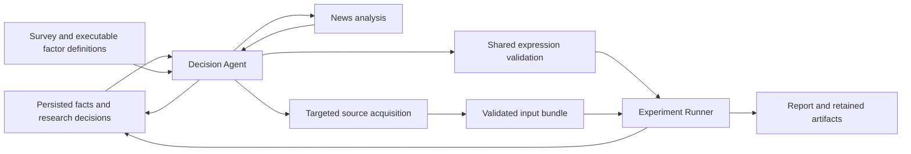

# News-driven candidate discovery

RFC [#119](https://github.com/natureofnature/Quant_RSI/issues/119) extends the existing
`research-study` entry point with `--research-mode discovery`. The research question
can lead to candidates absent from the initial catalog, including variables requiring
targeted source acquisition. A candidate is a hypothesis to test, not a claim of alpha.

## Run a connected study

Use the repository's existing Python environment and run from the checkout root:

```bash
quant-rsi research-study KO --research-mode discovery --llm codex \
  --news-research --historical-sessions 252 \
  --question "Which operating developments could explain changes in demand?" \
  --output /tmp/ko-news-discovery
```

The question need not name a factor or formula. `--news-research` permits the existing
search/read tools; external LLM and data calls may consume service usage. API mode
uses the existing `--llm api --llm-model MODEL` configuration. Optional `--financials`
and `--external-drivers` make their existing inputs available as well; they are not
the only possible candidate vocabulary.

In active discovery (`--research-mode discovery --news-research`, without retained
information mode), an instrument such as TSM does not need a configured relationship
profile or issuer RSS feed to begin. Missing seeds are recorded as `not_configured`,
with empty relationships and news; the researcher can search for evidence itself.
No receipt or historical news snapshot is invented. Failures from a configured target
RSS feed still stop the run. Legacy, incremental and non-active discovery retain their
existing configuration requirements.

Discovery keeps access failures as run-scoped feedback for later searches and preserves
them on resume. Hosts that deny access, rate-limit requests or resolve to non-public
addresses are avoided. An interrupted survey or acquisition replays its frozen search
context and completed reads; later source operations use the accumulated feedback.
Avoidance includes redirect destinations. Skipping a known denied host
before a read uses no additional read allowance; a read that encounters a denied
redirect still uses its existing allowance and records preceding HTTP requests.
Access receipts are transport metadata, not source evidence. This feedback neither
increases source budgets nor relaxes SSRF checks or access restrictions.

Native discovery binds each source operation to its frozen decision iteration, operation
kind and complete request. It can replay completed source work when writing the outer
checkpoint fails. Identical requests within one batch share the inner source operation;
each still consumes its existing outer acquisition slot. External orchestration that
wraps `DiscoverySources.survey` or `acquire` in an outer checkpoint must supply the
existing checkpoint callback and a stable `context.operation_id`, reuse that identity
on resume, and change it for a new logical operation.
Without that caller identity, a call after successful completion is a new investigation.

For an offline wiring example with simulated evidence, decisions and acquisition,
while retaining actual numerical feature calculation and model fitting:

```bash
quant-rsi research-study KO --research-mode discovery \
  --llm simulated --news simulated --related simulated --prices synthetic \
  --no-related-prices --no-history --no-ui \
  --question "Investigate operating demand beyond price controls" \
  --output /tmp/ko-discovery-fixture
```

The simulated researcher has programmed actions. Its output demonstrates module
connections and numerical execution, not autonomous discovery or predictive quality.
Use a fresh output directory; resume existing tasks through the existing study
recovery mechanism instead of overwriting their records.

Discovery defaults to three research fits and six decision actions. `--rounds` bounds
decision actions in this mode; `--max-fits` independently bounds baseline and candidate
fits. A survey, unavailable input or invalid candidate need not consume a fit. Acquiring
new inputs after an experiment can require a linked experiment and another baseline;
declare enough fit budget for that pair before execution. Four fits can cover
`B₁ → B₁+H₁ → B₂ → B₂+H₂`. There is no requirement for a candidate to improve the score.

Each decision sees the outer action limits, usage and remaining allowances. These are
separate from source search/read/extraction limits: unused article reads do not authorize
an additional survey after its action allowance is exhausted. A refused survey or
acquisition is retained in Memory as `not_executed` with the request, exhausted budget
and remaining action allowances. Later decisions and reports retain this diagnostic
even if the researcher subsequently stops; resume does not dispatch the refused request.

### Prepare factors without fitting a model

For native discovery, `--max-fits 0` prepares evidence, inputs and candidate columns
while retaining the normal decision, search and acquisition limits. For example:

```bash
quant-rsi research-study KO --research-mode discovery \
  --llm codex --llm-model gpt-6.1-sol --llm-reasoning-effort high \
  --news-research --historical-sessions 252 --horizon-sessions 3 \
  --max-fits 0 --rounds 6 \
  --question "Which operating disclosures justify a testable three-session return hypothesis?" \
  --output /tmp/ko-discovery-preparation
```

This is a **preparation-only** run: no baseline or candidate model is fitted, no
prediction or trading result is published, and no accuracy or predictive improvement
is evaluated. Data retrieval and LLM calls can still consume service usage. The
three-session setting describes this native study's close-to-close forecast target;
it does not reproduce another experiment's next-open entry target merely because
both use three sessions.

Preparation skips shared history registration, prior experiment feedback and forecast
outcome observation; its artifacts remain in the run's output directory. Its own
input gaps and validation results still inform later actions and survive resume.
This is not a complete model-feedback RSI experiment.

The report keeps three states distinct:

| State | What the retained evidence establishes |
| --- | --- |
| Inputs acquired | A source-bound acquisition receipt exists for an input used by the candidate; inspect source providers to distinguish actual disclosures from fixtures |
| Some rows computable | The expression produces values for some required dates, but coverage can still be incomplete |
| Full frozen population ready | Validation passes and every required training and development row is computable; this does not mean a model was trained or the factor is useful |

Preparation records preserve the candidate and recipe references, used input bindings,
acquisition and numerical source references, column identity and row coverage. The
evidence JSON retains computed values or explicit `null` values on the frozen training
and development population, with each row's prediction time. It does not add labels,
targets or reserved terminal rows to the preparation table. Semantic or schema
rejections may have no computed column: their reason remains visible rather than
being represented as a zero-valued factor. Missing values are never replaced with zero
just to claim readiness.

Use a separate fresh study with a positive fit budget when ready to test a candidate.
Keep the preparation artifacts intact; preparation does not establish a matched
baseline comparison, a selected model or the outcome of a later experiment.

## Modules and ownership



| Boundary | Implementation | Responsibility |
| --- | --- | --- |
| Entry and existing preparations | `research/study.py`, `research/study_discovery.py` | Select the mode, reuse retained prices/windows and providers, connect module callbacks, finish the existing report path |
| Outer research loop and Memory handoff | `research/discovery_loop.py` | Request bounded actions, persist completed facts before another decision, retain candidates, share budgets across linked experiments |
| Decision, news and acquisition interfaces | `research/discovery_sources.py` | Structured LLM output, targeted searches/reads, evidence-linked numerical extraction and input alignment |
| Shared Factor DSL | `factors/expressions.py` | Versioned bounded expression DAG, causal numerical calculation, missing-value behavior and normalized identities |
| Survey and candidate definitions | `research/discovery_factors.py` | Retrieve known specifications, resolve executable adapters, bind novel expressions to supplied inputs |
| Numerical execution | `research/discovery_engine.py`, `research/demo_model.py` | Adapt admitted columns to existing training and strategy evaluation; never decide the next research question |
| Policy and admission checks | `research/discovery_contracts.py` | Effective policy identities, allowed patches and deterministic context/numerical/feedback gates |
| Presentation | `research/study_report.py`, `research/discovery_report.py` and existing workbench | Show candidate lineage, experiments, actual usage and reasons for stopping |

These are Python module boundaries, not separate services. The outer loop owns the next
investigation; the Experiment Runner returns measurements or diagnostics. Workflow code
persists measured results independently of the agent's subsequent interpretation.

Recovery restores admitted article bodies, source identities and temporal provenance along
with cumulative usage from completed source operations. Replaying a cached survey therefore
does not require another search or download before retrying a failed extraction.

Completed research enters shared history even when incomparable experiments produce no
single selected forecast. Its experiment facts remain available to subsequent research with
their comparison boundaries; it creates no forecast publication or settlement. Bounded
Memory retrieval prioritizes measured experiment/acquisition facts over intervening decisions.

## Experimental survey and executable factors

All 32 detailed records in `experimental/candidate_factors/definitions/` are available
to bounded survey retrieval, with source revisions, license references, input
requirements and execution status. The 341 raw inventory entries remain a lower-assurance
index: they include templates, helpers and duplicates. They are not 341 runnable factors.

The executable surveyed subset is:

| Survey record | Local calculation | Inputs |
| --- | --- | --- |
| `qlib.roc` | `close[t-window] / close[t]` | Full positive close-price window |
| `qlib.ma` | `mean(close[t-window+1:t+1]) / close[t]` | Full positive close-price window |
| `qlib.kmid` | `(close[t] - open[t]) / open[t]` | Positive finalized open and close |

ROC is Qlib's inverse price ratio, not conventional percentage return. The new KMID
adapter measures an intrabar price change; it does not measure business demand. These
are local numerical implementations, not calls into installed Qlib. See the retained
[source notices](../experimental/candidate_factors/THIRD_PARTY_NOTICES.md).

The other survey records remain discoverable with missing-input/operator diagnostics.
The noncausal reference-only specification cannot become a forecasting feature. Availability
of an operator does not imply that its numerical values cover a particular experiment.

## Expressions absent from the catalog

Decision Agent can submit a new expression without adding a hand-written factor entry.
Version two of the shared grammar supports leaves, addition, subtraction, multiplication,
division, lag, rolling mean, sample standard deviation and rolling z-score. Temporal
operators have explicit windows, complete trailing observations and no future access.
Division by zero, nonfinite values and constant-window z-scores remain missing. Known
incompatible units cannot be added or subtracted. Graph size, depth and windows are bounded.

Leaves bind to declared raw prices, surveyed outputs, existing business inputs or acquired
series. Missing leaves produce acquisition diagnostics. Unsupported operators remain
capability requests; a formula cannot execute arbitrary Python, shell commands or network
access. Existing version-one expression serialization and recipe identities are preserved.

Candidate names do not establish novelty. The normalized recipe identity removes incidental
node names, binding aliases and supported commutative ordering. Exact input versions and
experiment identities are retained separately for reproduction.

New candidate proposals also carry `parent_recipe_refs`: explicit recipe identities
of the earlier candidates being revised or replaced. This is research lineage, not a
numerical dependency. The decision receives an index of candidates present in its
admitted Memory; unknown, invisible and self references are rejected before acquisition
or fitting. A new `revise` response must name a parent for each candidate. Unrelated
hypotheses use `test` with an empty parent list.

Parent metadata does not change semantic recipe identities or bypass duplicate-fit
checks. Each declaration, including rejected or numerically duplicate proposals, remains
in the decision record and the report's **Candidate revisions** table. Historical records
without this field remain readable and are labeled unspecified; their parentage is not
invented or written back into preserved runs. See the [RFC evidence map](rfc119_acceptance.md)
for the distinction between historical execution records and current lineage validation.

## Business mechanisms, related entities and forecast targets

Native discovery can survey a symbol other than the experiment's target. The research
question determines which customers, suppliers or downstream payers to investigate;
there is no fixed buyer list. A source-backed relationship is an investigation lead,
not proof that one company's operating results cause another company's stock return.
Survey findings can retain proposed relationships as `from_entity`, `to_entity`,
`relationship`, `source_id` and a literal supporting `excerpt`. A direct customer,
downstream payer and general industry trend are different claims. Unsupported links
remain gaps rather than being promoted to established relationships.

An optional candidate `hypothesis` separates the business explanation from the price
forecast being tested:

| Field | Meaning |
| --- | --- |
| `operating_mechanism` | Proposed business mechanism connecting the measurements |
| `measurement_horizon` | The operating period, such as a calendar quarter |
| `forecast_channel` | Why that information might affect the experiment's forecast target; nullable when unsupported |
| `forecast_horizon_sessions` | The actual forecast horizon in trading sessions |
| `relationships` | Proposed entity links with retained source IDs and literal supporting quotes |

A quarterly operating mechanism does not establish a short-horizon price signal.
An absent forecast channel remains `needs_data`; supplying a channel states a testable
hypothesis, not evidence that it works. The forecast horizon must follow the actual
experiment, independently of the measurement period. Reports show both horizons and
label the relationships as proposed, evidence-quoted links. Legacy candidates without
this block remain readable without inferred mechanisms, horizons or relationships.

Acquisition requests can supply another company's measurements to the target experiment.
`request.symbol` identifies the **source entity**, while the experiment retains its
own forecast target. Each acquired input still declares its measurement and unit and
retains source excerpts, periods and availability evidence. Reports show the source
symbol alongside each requested measurement and retained observation, making unintended
subject substitutions inspectable. These records do not independently verify that the
quoted number belongs to the requested company or accounting basis; source interpretation
still requires review.

Missing units, incompatible periods, unavailable private-company disclosures and
unsupported entity mappings remain explicit survey or acquisition gaps. A private
entity may be named as a relationship lead without inventing a public ticker or an
executable data source. Revenue, capital expenditure, operating cash flow, utilization
and financing needs can motivate investigations, but a simple cash-flow-minus-capex
calculation is not automatically a verified financing gap. Existing timing, coverage
and formula admission rules continue to apply to cross-company inputs. Offline
engineering fixtures demonstrate the data path, not predictive improvement.

## Data, time and comparison rules

Acquisition retains source excerpts, URLs, publication/receipt/version timestamps,
measurement periods, units and extracted observations. Per-row evidence identifies which
observation supplied each numerical value. A declared last-disclosed-value rule may reuse
an observation within its maximum age; repeated daily copies are not independent historical
measurements. Values are not backfilled before their effective availability.

### Published quarterly expectations

Active discovery can acquire a published forecast without treating it as an actual
result. A `DataRequest` declares optional forecast metadata, for example:

```json
{"forecast": {"product": "conventional DRAM", "statistic": "lower",
              "basis": "QoQ contract-price growth", "pairing_group": "memory_prices"}}
```

Use `forecast: null` for realized measurements. An extracted forecast retains a
`target_quarter` such as `2026-Q1`, exact calendar-quarter start/end dates, the literal
quarter excerpt (`1Q26` or `Q1 2026`), the numerical excerpt and publication evidence.
A future target quarter is permitted; a future publication is not. Fiscal-quarter
mappings are not supported. Named-month dates such as `5 January 2026` are accepted
without relaxing ambiguous numeric date checks. Product, statistic and basis are
declared measurement semantics; literal checks alone do not independently verify the
financial interpretation, so source interpretation review remains necessary.

Alignment uses the latest disclosed forecast vintage, then its latest target quarter,
within the request's maximum age. It never uses a later revision at an earlier row.
Retained mode still requires receipt/version/extraction availability. Forecast metadata,
alignment policy and per-row source/publication/target keys enter the input identity.
Existing realized requests and observations omit the new nullable fields, preserving
their previous serialization and successful replay identities.

Matching is opt-in: inputs with the same non-null `pairing_group`, used together in a
candidate, must share the source article, publication vintage and target quarter on
each row. Unmatched rows remain missing; the executor does not silently fall back to
an older common pair. Different groups or null groups allow independent expectations.
The generated candidate definition retains the pairing requirement. For paired inputs,
combine the values first and apply any lag/rolling operations as an outermost unary
chain. `lag(DRAM - NAND)` is supported; `lag(DRAM) - NAND` is rejected because it can
mix different forecast vintages. Both study and rolling candidate execution enforce
these rules; unused forecast bundles do not impose constraints on other candidates.

#### Realized actual versus its own guidance range

Independent latest-value alignment is insufficient for this comparison: a Q1 actual
release often also announces Q2 guidance. A candidate can explicitly request:

```json
{"realization_alignment": {"version": 1, "actual": "actual_gm",
  "lower": "guidance_lower", "upper": "guidance_upper", "policy": "latest_pre_actual"}}
```

These are the candidate's input **binding names**. Both bounds need matching forecast
product, accounting basis, pairing group, issuer and unit. The actual request declares
the same `realized_measure.product` and `realized_measure.basis`, plus reviewed anchors:

```json
{"original_actual_releases": [{
  "period_start": "2026-01-01", "period_end": "2026-03-31",
  "source_url": "https://example.com/original-earnings-release",
  "publication_date": "2026-04-16",
  "release_excerpt": "Results for the first quarter ended March 31, 2026."
}]}
```

This is an illustrative schema, not issuer evidence. An anchor is an admission
constraint, not evidence on its own: source URL, publication date, full calendar
quarter and literal current-quarter release excerpt must match retained source text.
Quarter labels such as `2026-Q1` or `first quarter ended March 31, 2026` establish
calendar boundaries only under this opt-in; monthly, YTD and fiscal scopes are not
accepted. Publication still requires an exact date. Review must establish that the
designated source reports that quarter's actual and the same accounting measure.
The observation's own period and value excerpts are checked separately from the
release heading; a quarterly heading cannot admit a cumulative value. This narrow
adapter does not accept `three months ended` wording: use a verified quarterly header
or exact matching full-quarter bounds without conflicting scope, otherwise retain the gap.
The system does not infer a globally first disclosure from the earliest fetched record.

Both study and rolling execution resolve a **candidate-local** view from admitted raw
histories before screening or computing features. Select the latest already-published
designated actual quarter, then the latest same-quarter guidance strictly published
before that release. Bounds must come from one source/publication; a missing or
conflicting newest range does not fall back to an older complete one. Missing actuals,
unavailable receipts, expired inputs, mismatched periods and nonpositive range widths
remain missing with reasons. Date-only same-day releases cannot establish ordering.
Later comparative/restated actuals cannot silently move the anchor. Existing generic
latest-forecast recipes are unchanged.

The relation enters recipe identity; source anchors enter input identity. Execution
evidence records selected observation IDs, source IDs, periods, publication/availability
times and missing reasons. Replay uses retained source and extraction receipts.
Dependency probes operate on the prepared numerical columns, without resolving raw
values again. Combine the actual and both bounds before applying outermost temporal
operators. For `(actual - lower) / (upper - lower)`, values outside `[0, 1] are valid.
This measures realization relative to management guidance, **not analyst consensus or
market surprise**. Repeated daily quarter values are not independent disclosures;
source admission and successful execution do not establish predictive usefulness.

#### Realized calendar-month measurements

Realized monthly disclosures can opt in with
`"period_granularity": "calendar_month"` on `DataRequest`. A literal month and year
in the quoted period evidence then identify exactly that month's first and last
calendar dates, including leap-year February. Missing boundaries, partial months,
fiscal-month mappings, mismatched months and future realized periods are rejected.
This setting is incompatible with `forecast`; the default `null` retains exact-date
period checks and is omitted from serialized requests to preserve existing identities.
Publication still requires a literal exact day: `Jan. 9, 2026` is supported, while
`January 2026` cannot establish a publication date. Original excerpts are retained.
Month admission does not validate the financial meaning of a table row: current-month
YoY, MoM and cumulative growth must still be distinguished during extraction and review.
Receipt/version cutoffs, the existing maximum-age rule and missing-value behavior are
unchanged. A monthly disclosure cannot become available at month-end before publication.

An executable formula is not necessarily a trainable candidate: the fixed training
and prediction rows must still have complete inputs. Missing releases remain a data
acquisition task; do not extend the maximum age or remove rows solely to pass admission.

A bounded SOXX integration run on 2026-11-05 used Codex `gpt-6.1-sol` with high
reasoning effort to search an additional release and extract both forecast lower
bounds from four TrendForce publications ([January 5](https://www.trendforce.com/presscenter/news/20260105-12860.html),
[February 2](https://www.trendforce.com/presscenter/news/20260202-12911.html),
[March 31](https://www.trendforce.com/presscenter/news/20260331-12995.html),
[July 3](https://www.trendforce.com/presscenter/news/20260703-13134.html)). Eight observations
passed source checks and the same-release DRAM-minus-NAND lower-bound difference
computed on 87 of 126 retained historical rows. With the original 45-day maximum
age, 39 of 93 training rows remained missing, although the prediction row was covered.
The unchanged-sample admission check rejected fitting: **zero fits, no performance
result**. This is current-time retrospective acquisition evidence, not a historically
blind test, and four releases from one provider are not independent confirmations.

Retrospective research can use current evidence to motivate historical experiments and
must disclose reconstructed historical availability. Retained mode requires the existing
historical receipt/version proofs before evidence enters any agent context. Selecting a
date range alone does not provide historical information isolation, and filtering supplied
evidence cannot remove pretrained LLM knowledge.

Experiment samples, labels, baselines and metrics remain fixed. Missing candidate values
do not silently drop rows. Changed input domains require linked matched experiments and
charge their baselines to the same total budget. Compare improvements within compatible
experiments. Incompatible populations do not produce a global leaderboard; publication
requires a declared selection rule or an explicit choice.

Training labels must have matured at fit time. Terminal results stay outside active
research feedback and Memory retrieval. A latest forecast, if published, is separate from
historical development and terminal evaluation.

## Evidence and completion status

### TSM original-release alignment pilot (2026-11-07)

A real Codex session (`gpt-6.1-sol`, high effort) submitted one typed acquisition
decision and completed three literal extractions for an existing news-derived
gross-margin guidance-position hypothesis. It used TSMC's
[January 15 original release](https://investor.tsmc.com/japanese/encrypt/files/encrypt_file/reports/2026-01/3e49621566a3ca53bdf8aee2586929b666c17fd6/4Q25EarningsRelease.pdf)
for Q1 2026 guidance of 63%–65%, and its
[April 16 original release](https://investor.tsmc.com/english/encrypt/files/encrypt_file/reports/2026-04/e85216eea8dccd8ca75d7e040e8d57be3ccd618b/1Q26%20EarningsRelease.pdf)
for the same quarter's actual gross margin of 66.2%.

The executable relation produced `(66.2 - 63) / (65 - 63) = 1.6`; all three
acquisition bundles replayed identically from retained text/extraction receipts.
The candidate recipe identity is
`2828d9c57f64f3f64e933e9631dc05a13724c1b678ed8c4a7a0dda36430952e1`.
The acquisition runtime was `a0b4c40`; original decisions, receipts, selected
observation IDs and the earlier negative monthly-revenue experiment were preserved.

This is **one independent quarterly event and zero model fits**, demonstrating
source-to-feature execution only. Source text was retrieved retrospectively;
publication dates do not establish archived historical bytes or past receipt times.
The January 1 boundary is normalized from the stated calendar quarter, not a literal
date in the release. Guidance assumes USD/NTD 31.6, so the measurement is not a pure
demand signal, analyst consensus surprise, or evidence of predictive improvement.

Implementation and offline tests are not the complete RFC acceptance. Completion also
requires a recorded real-service lineage connecting the **same candidate** from news to
new data, fitted feature columns and feedback; an authentic two-candidate outer-loop
trajectory; planned news-ablation and counterfactual-feedback observations; required final
validation; and actual browser acceptance for browser usability claims.

A useful negative result can satisfy execution acceptance; neither successful execution
nor a lower development error establishes independent predictive gain or profitability.
The records below distinguish completed execution witnesses from inconclusive observations.
Do not close the RFC by treating an inconclusive news-influence observation as a pass.

### Recorded implementation validation (2026-11-04)

The offline integration exercises an absent operating-demand input, acquisition, two
different temporal expressions and three actual LightGBM fits. Its providers and prices
are simulated. Regression coverage also checks unchanged experiment rows, rejection of
fabricated evidence, cross-study retrieval of measured feedback, and recovery without
repeating completed training. Failed source calls and failed fit attempts retain their
budget charges across recovery; reporting failures after a saved fit do not charge another
fit. Publication-only latest forecasts do not enter research feedback.

Real-service exploration records remain separate from that fixture:

| Observation | Outcome and limitation |
| --- | --- |
| KO attempt 01 | Codex proposed a guidance-derived input; unsupported arithmetic extraction and exhausted acquisition allowance led to a baseline-only report. This is not a discovery witness. |
| KO attempt 02 | Codex proposed a pricing/volume mechanism. A legitimate issuer date format was rejected and headline-only extraction wasted allowance. The run stopped at baseline; regressions now cover both defects. Original records remain unchanged. |
| KO attempt 03 | The first Codex decision timed out before fitting. Resume refused after source changes, preserving the original runtime identity. |
| KO attempt 04, runtime commit `2d19657` | An initial RSS failure resumed on the unchanged runtime. Codex acquired two literal quarterly operating measurements and synthesized a five-session change in the pricing/volume gap. The resulting column entered a real fit. After reading its actual feedback, Codex revised it to the persistent gap level and fitted again. Both candidates used the same acquired inputs and fixed samples. |
| Preregistered news ablation, one Codex pair | **Inconclusive.** Removing the earnings/guidance headline changed the cited evidence, but both arms still proposed a pricing/volume gap. Retained earnings context and pretrained knowledge are alternative explanations. |
| News-body ablation, two preregistered Codex pairs at `a4431c6` | **Pass under the declared qualitative information-use criterion.** Both original arms cite concrete operating facts and request volume/price-mix measurements; both removal arms turn to dividend amounts and a dividend/price expression. All four calls completed without retries. No acquisition or fitting ran in these pairs. The [evidence map](rfc119_acceptance.md#news-body-paired-observation-e7) preserves the plan, independent assessment and limitations; the earlier headline-only result remains inconclusive. |
| Preregistered synthetic-feedback intervention, one Codex pair | The favorable branch retained the proposed pricing/volume investigation; the unfavorable branch explicitly cited the worse synthetic MAE and proposed a temporal currency-impact measurement. This meets the declared qualitative action-sensitivity criterion, without establishing statistical causality or predictive benefit. |

Paired plans, effective input contexts and all outputs were retained before assessment.
Synthetic feedback never entered authentic study memory. These bounded observations do
not establish general reliability. The harness is `examples/discovery_acceptance.py`;
each plan fixes the provider, maximum pairs, intervention and observable criteria before
any calls. Its default result is inconclusive until an explicit evidence review is recorded.

Attempt 04 completed four decisions, two acquisition requests and three fits. The baseline
and first candidate each had development price MAE **2.5450**; the revision had **2.5586**.
The researcher stopped with one fit still available and retained the baseline. Each candidate
had two distinct training values, sourced from only two quarterly disclosures; daily repeats
are not additional observations. This is an authentic discovery/acquisition/feedback witness,
with no predictive-gain claim. The prior stopped and failed attempts were not overwritten.

Actual Chromium acceptance launched discovery from the workbench with simulated providers
and real LightGBM, then opened the live view, history and full report. The live view showed
three fits, four of six decision actions, zero real LLM requests and the matched results.
Source lineage and feature tables were inspected at desktop and mobile widths. The real
attempt-04 report was also inspected separately. These browser checks establish usability,
not predictive quality. Focused UI checks and 14 actual Qlib integration tests passed.
The implementation PR must report final-revision full validation and any remaining failures
separately from these service/browser observations.
